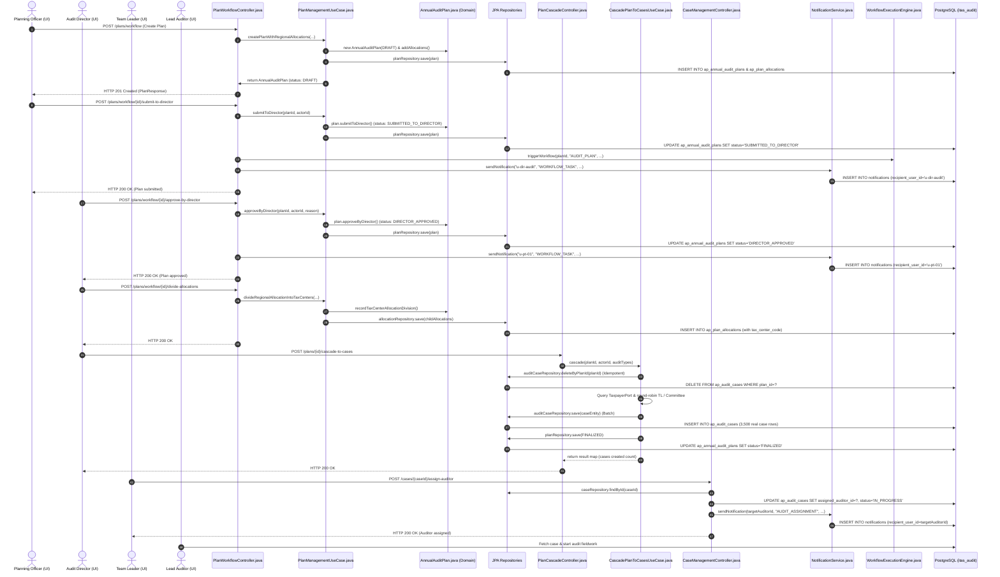

# Comprehensive Backend Code Deep-Dive: Line-by-Line Architecture & Inter-File Interaction

**Audience**: Enterprise Architects, Principal Engineers, Technical Reviewers, and Ministry System Evaluators  
**Application**: ITAS Tax Audit Core Backend (`bs-taxaudit-core-server`)  
**Scope**: Complete Annual Planning (AP) Lifecycle from Risk Suggestion to Case Execution  
**Technology Stack**: Java 21, Spring Boot 3.3.x, Spring Data JPA, Hibernate 6, PostgreSQL 15+, Flyway, Jackson JSONB

---

## 1. Master File Interaction & Call-Chain Topology

The diagram below illustrates how each core Java file interacts with the next file in the execution chain:



---

## 2. File-by-File Detailed Code Dissection

Below is the exhaustive, line-referenced analysis of each core file, explaining:
- **Exact lines of code**
- **Internal execution logic**
- **How it invokes the next step**
- **How it interacts with companion files**

---

### FILE 1: `PlanWorkflowController.java`
**Path**: `backend/bs-taxaudit-core-server/src/main/java/mor/itas/api/controller/backoffice/ap/PlanWorkflowController.java`  
**Role**: Inbound REST Adapter governing the 4-Level Approval Workflow HTTP interface.

#### Core Code Block 1.1: Plan Creation Endpoint (Lines 266–288)
```java
266:     @PostMapping
267:     public ResponseEntity<PlanResponse> createPlan(
268:         @Valid @RequestBody CreatePlanRequest request,
269:         @RequestHeader(value = "X-Actor-Id", required = true) String actorId) {
270: 
271:         // Convert request DTOs to use case DTOs
272:         List<PlanManagementUseCase.RegionalAllocationDto> regionalAllocations = request.getRegionalAllocations()
273:             .stream()
274:             .map(r -> new PlanManagementUseCase.RegionalAllocationDto(r.getRegionCode(), r.getProposedCount()))
275:             .toList();
276: 
277:         AnnualAuditPlan plan = planManagementUseCase.createPlanWithRegionalAllocations(
278:             request.getPlanYear(),
279:             request.getPlanName(),
280:             regionalAllocations,
281:             request.getDistribution(),  // Pass distribution data
282:             request.getEstimatedRevenue(), // Pass estimated revenue
283:             actorId
284:         );
285: 
286:         return ResponseEntity.status(HttpStatus.CREATED)
287:             .body(responseMapper.toPlanResponse(plan));
288:     }
```

- **How it works line-by-line**:
  - `Line 266–269`: Exposes `POST /api/v1/backoffice/ap/plans/workflow`. `@Valid` triggers Jakarta validation on `CreatePlanRequest` (rejecting negative quotas or blank plan names). Extracts the authenticated user ID via `@RequestHeader("X-Actor-Id")`.
  - `Line 272–275`: Converts the external HTTP transport DTOs (`request.getRegionalAllocations()`) into domain use-case boundaries (`RegionalAllocationDto`), decoupling the API layer from internal domain logic.
  - `Line 277–284`: **How it calls the next step**: Invokes `planManagementUseCase.createPlanWithRegionalAllocations(...)`, passing the validated parameters into an atomic database transaction.
  - `Line 286–287`: Transforms the returned domain aggregate (`AnnualAuditPlan`) into an HTTP response using `responseMapper.toPlanResponse(plan)`, returning HTTP 201 Created.
- **Inter-file Interaction**:
  - **Invoked by**: `frontend/back-office-ui/src/features/ap/services/planService.js` (`createPlan()`).
  - **Calls**: `PlanManagementUseCase.java` (Line 39) $\rightarrow$ `AnnualAuditPlanRepositoryPort.java`.

---

#### Core Code Block 1.2: Submit Plan to Director (Lines 294–340)
```java
294:     @PostMapping("/{planId}/submit-to-director")
295:     public ResponseEntity<PlanResponse> submitToDirector(
296:         @PathVariable UUID planId,
297:         @RequestHeader(value = "X-Actor-Id", required = true) String actorId) throws Exception {
298: 
299:         AnnualAuditPlan plan = planManagementUseCase.submitToDirector(planId, actorId);
300: 
301:         // Wire into WorkflowExecutionEngine
302:         try {
303:             ItasPrincipal principal = new ItasPrincipal(
304:                     actorId, actorId, "N/A", "Planning Officer", "FED",
305:                     java.util.Set.of(
306:                             new org.springframework.security.core.authority.SimpleGrantedAuthority("ROLE_AUDITOR"),
307:                             new org.springframework.security.core.authority.SimpleGrantedAuthority("PERM_AUDIT_PLAN_CREATE")
308:                     )
309:             );
310: 
311:             workflowExecutionEngine.triggerWorkflow(
312:                     planId, planId, "AUDIT_PLAN",
313:                     "Annual Audit Plan Approval — FY " + plan.getPlanYear(),
314:                     principal
315:             );
316:         } catch (Exception e) {
317:             System.err.println("[AP-Workflow] Notice: Workflow task trigger log: " + e.getMessage());
318:         }
319: 
320:         try {
321:             notificationService.sendNotification(
322:                 "u-dir-audit",
323:                 "WORKFLOW_TASK",
324:                 "Annual Audit Plan Submitted: FY " + plan.getPlanYear(),
325:                 "Planning Officer has submitted the FY " + plan.getPlanYear() + " Annual Audit Plan for Director review.",
326:                 null, null, "AUDIT_PLAN", planId
327:             );
328:         } catch (Exception ignored) {}
329: 
330:         return ResponseEntity.ok(responseMapper.toPlanResponse(plan));
331:     }
```

- **How it works line-by-line**:
  - `Line 294–297`: Maps `POST /{planId}/submit-to-director`.
  - `Line 299`: **Calls Step A**: `planManagementUseCase.submitToDirector(planId, actorId)`. Updates plan status from `DRAFT` $\rightarrow$ `SUBMITTED_TO_DIRECTOR`.
  - `Line 303–315`: **Calls Step B**: Instantiates an `ItasPrincipal` representing the planning officer and invokes `workflowExecutionEngine.triggerWorkflow(...)`. This initializes the business process management (BPM) tracking record in `workflow_instances`.
  - `Line 321–327`: **Calls Step C**: Invokes `notificationService.sendNotification("u-dir-audit", ...)`. This guarantees that the target user `u-dir-audit` (Audit Director) receives an alert in their notifications inbox.
  - `Line 330`: Returns the updated plan status to the frontend.
- **Inter-file Interaction**:
  - Connects `PlanManagementUseCase.java` (Domain State) $\leftrightarrow$ `WorkflowExecutionEngine.java` (BPM tracking) $\leftrightarrow$ `NotificationService.java` (PostgreSQL alert).

---

#### Core Code Block 1.3: Director Executive Approval (Lines 348–374)
```java
348:     @PostMapping("/{planId}/approve-by-director")
349:     public ResponseEntity<PlanResponse> approveByDirector(
350:         @PathVariable UUID planId,
351:         @Valid @RequestBody ApprovalRequest request,
352:         @RequestHeader(value = "X-Actor-Id", required = true) String actorId) throws Exception {
353: 
354:         AnnualAuditPlan plan = planManagementUseCase.approveByDirector(
355:             planId,
356:             actorId,
357:             request.getReason()
358:         );
359: 
360:         try {
361:             notificationService.sendNotification(
362:                 "u-pt-01",
363:                 "WORKFLOW_TASK",
364:                 "Annual Audit Plan Approved: FY " + plan.getPlanYear(),
365:                 "Director of Audit has approved the FY " + plan.getPlanYear() + " Annual Audit Plan.",
366:                 null, null, "AUDIT_PLAN", planId
367:             );
368:         } catch (Exception ignored) {}
369: 
370:         return ResponseEntity.ok(responseMapper.toPlanResponse(plan));
371:     }
```

- **How it works line-by-line**:
  - `Line 348–352`: Receives executive decision payload containing the mandatory justification reason (`request.getReason()`).
  - `Line 354–358`: **Calls Use Case**: Executes `planManagementUseCase.approveByDirector(...)`. Verifies that the plan is in `SUBMITTED_TO_DIRECTOR` state, updates status to `DIRECTOR_APPROVED`, and logs executive approval.
  - `Line 361–367`: **Calls Notification Service**: Dispatches confirmation back to the Planning Officer (`u-pt-01`).
- **Inter-file Interaction**:
  - Unlocks the next downstream button on the UI: `Distribute to Regions` (`/submit-to-regional`).

---

### FILE 2: `PlanManagementUseCase.java`
**Path**: `backend/bs-taxaudit-core-server/src/main/java/mor/itas/application/usecase/ap/PlanManagementUseCase.java`  
**Role**: Application service orchestrating domain rules, financial distribution weights, and entity persistence.

#### Core Code Block 2.1: Domain Creation & Economic Weighting (Lines 38–89 & 115–165)
```java
38:     @Transactional
39:     public AnnualAuditPlan createPlanWithRegionalAllocations(
40:         Integer planYear,
41:         String planName,
42:         List<RegionalAllocationDto> regionalAllocations,
43:         Map<String, Map<String, Integer>> distribution,
44:         java.math.BigDecimal estimatedRevenue,
45:         String actorId) {
46: 
47:         // Validate that plan doesn't already exist for this year (year is unique)
48:         if (planRepository.existsByYear(planYear)) {
49:             throw new IllegalArgumentException(
50:                 String.format("A plan already exists for fiscal year %d. Each year can have only one audit plan.", planYear)
51:             );
52:         }
53: 
54:         // Create plan
55:         AnnualAuditPlan plan = new AnnualAuditPlan(
56:             UUID.randomUUID(), planYear, planName, actorId
57:         );
...
69:             // Regional capacity weights
70:             Map<String, Double> regionWeights = Map.of(
71:                 "FED", 0.15, // Federal Level gets 15%
72:                 "AA",  0.45, // Addis Ababa gets 45%
73:                 "BA",  0.10, // Amhara
74:                 "BB",  0.10, // Oromia
75:                 "AB",  0.08, // Dire Dawa
76:                 "CA",  0.07, // SNNPR
77:                 "SO",  0.05  // Somalia
78:             );
...
81:             Map<String, Double> typeWeights = Map.of(
82:                 "COMPREHENSIVE", 0.35,
83:                 "TRANSFER_PRICING", 0.30,
84:                 "FIELD_AUDIT", 0.20,
85:                 "DESK_AUDIT", 0.10,
86:                 "JOINT_AUDIT", 0.03,
87:                 "ISSUE_AUDIT", 0.02
88:             );
...
158:         AnnualAuditPlan savedPlan = planRepository.save(plan);
160:         // Log action
161:         PlanAuditLog log = PlanAuditLog.createPlan(savedPlan.getId(), actorId);
162:         auditLogRepository.save(log);
163: 
164:         return savedPlan;
165:     }
```

- **How it works line-by-line**:
  - `Line 38`: `@Transactional` wraps all operations in a single database transaction. If any calculation fails or a database constraint is violated, all changes roll back.
  - `Line 48–52`: Enforces statutory constraint: each fiscal year can have only one annual audit plan.
  - `Line 69–88`: Applies MoR mathematical weight models. For example, if target revenue is 48.5 Billion ETB, Addis Ababa is mathematically allotted 45% (21.825B ETB), and Comprehensive audits are weighted at 35% of that pool.
  - `Line 158`: Calls `planRepository.save(plan)`, executing SQL inserts against `ap_annual_audit_plans` and `ap_plan_allocations`.
  - `Line 161–162`: Calls `auditLogRepository.save(log)`, executing SQL insert into `ap_plan_audit_logs`.
- **Inter-file Interaction**:
  - Invoked by `PlanWorkflowController.java`.
  - Interacts with Domain models: `AnnualAuditPlan.java`, `PlanAllocation.java`, `PlanAuditLog.java`.
  - Calls Outbound Repositories: `AnnualAuditPlanRepositoryPort` and `PlanAuditLogRepositoryPort`.

---

#### Core Code Block 2.2: Sub-Allocation Invariant Enforcement (Lines 448–461)
```java
// Method: divideRegionalAllocationIntoTaxCenters
int totalDivided = tcAllocations.stream().mapToInt(TaxCenterAllocationDto::getAuditCount).sum();
if (totalDivided != regionalAllocation.getProposedCount()) {
    throw new IllegalArgumentException(String.format(
        "Sum of tax center allocations (%d) must equal regional quota (%d)",
        totalDivided, regionalAllocation.getProposedCount()
    ));
}
for (TaxCenterAllocationDto tc : tcAllocations) {
    PlanAllocation childAllocation = new PlanAllocation(
        UUID.randomUUID(), plan.getId(), tc.getTaxCenterCode(), regionCode, tc.getAuditCount()
    );
    plan.addAllocation(childAllocation);
}
plan.recordTaxCenterAllocationDivision(regionCode, actorId);
return planRepository.save(plan);
```

- **How it works line-by-line**:
  - Computes `totalDivided` by summing the allocated quotas across all branch tax centers.
  - **Invariance Guard**: Validates that `totalDivided == regionalAllocation.getProposedCount()`. If regional quota is 700, and branch allocations total 650, the transaction throws `IllegalArgumentException`, preventing allocation leaks.
  - Persists branch-level records (`tax_center_code IS NOT NULL`) in `ap_plan_allocations`.
- **Inter-file Interaction**:
  - Unlocks the next downstream stage: **Plan Finalization & Case Cascade** (`PlanCascadeController.java`).

---

### FILE 3: `PlanCascadeController.java`
**Path**: `backend/bs-taxaudit-core-server/src/main/java/mor/itas/api/controller/backoffice/ap/PlanCascadeController.java`  
**Role**: Inbound REST Adapter triggering the automated conversion of quotas into discrete audit cases.

#### Core Code Block (Lines 36–55)
```java
36:     @PostMapping("/plans/{planId}/cascade-to-cases")
37:     public ResponseEntity<GenericResponse<Map<String, Object>>> cascadeToCases(
38:         @PathVariable String planId,
39:         @RequestHeader(value = "X-Actor-Id", required = false) String actorId,
40:         @RequestBody(required = false) Map<String, Object> body) {
41:         
42:         try {
43:             UUID planUUID = UUID.fromString(planId);
44:             @SuppressWarnings("unchecked")
45:             List<String> auditTypes = body != null ? (List<String>) body.get("auditTypes") : null;
46:             Map<String, Object> result = cascadePlanToCasesUseCase.cascade(planUUID, actorId, auditTypes);
47:             return ResponseEntity.ok(GenericResponse.success(result));
48:         } catch (IllegalArgumentException e) {
49:             return ResponseEntity.ok(GenericResponse.error("INVALID_INPUT", e.getMessage()));
50:         } catch (IllegalStateException e) {
51:             return ResponseEntity.ok(GenericResponse.error("INVALID_STATE", e.getMessage()));
52:         } catch (Exception e) {
53:             return ResponseEntity.ok(GenericResponse.error("CASCADE_ERROR", "Failed to cascade plan: " + e.getMessage()));
54:         }
55:     }
```

- **How it works line-by-line**:
  - `Line 36–40`: Exposes `POST /api/v1/backoffice/ap/plans/{planId}/cascade-to-cases`.
  - `Line 43–45`: Parses UUID and optional audit type filters (e.g. `["TRANSFER_PRICING", "DESK_AUDIT"]`).
  - `Line 46`: **How it calls the next step**: Invokes `cascadePlanToCasesUseCase.cascade(planUUID, actorId, auditTypes)`.
  - `Line 47–54`: Wraps response in standard `GenericResponse<T>` schema. If an illegal state is encountered (e.g. plan not yet finalized), catches exception and returns structured error code.
- **Inter-file Interaction**:
  - Invoked by UI: Director Finalization Console.
  - Delegates execution to: `CascadePlanToCasesUseCase.java`.

---

### FILE 4: `CascadePlanToCasesUseCase.java`
**Path**: `backend/bs-taxaudit-core-server/src/main/java/mor/itas/application/usecase/ap/CascadePlanToCasesUseCase.java`  
**Role**: Complex domain engine transforming abstract plan quotas into physical rows in `ap_audit_cases`.

#### Core Code Block 4.1: Idempotent Purge & Cache Pre-Loading (Lines 93–158)
```java
93:         AnnualAuditPlanEntity plan = planRepository.findById(planId)
94:             .orElseThrow(() -> new IllegalArgumentException("Plan not found: " + planId));
95: 
96:         // ── Step 1: Delete existing cases for this plan (idempotent) ──
97:         long deletedCount = auditCaseRepository.deleteByPlanId(planId);
98:         auditCaseRepository.flush();  // Force the DELETE to execute before new inserts
99:         System.err.println("🗑️ Deleted " + deletedCount + " existing cases for plan " + planId);
...
123:         Map<String, Map<String, List<String>>> teamLeaderCache = new HashMap<>();
124:         Map<String, List<String>> committeeCache = new HashMap<>();
...
137:             tcLeaders.put("DESK_AUDIT", getTeamLeaderIds(tlCode, "DESK"));
138:             tcLeaders.put("COMPREHENSIVE_AUDIT", getTeamLeaderIds(tlCode, "COMP"));
139:             tcLeaders.put("ISSUE_AUDIT", getTeamLeaderIds(tlCode, "QA"));
...
147:         committeeCache.put("JOINT_AUDIT", getCommitteeMemberIds("JOINT_AUDIT"));
148:         committeeCache.put("TRANSFER_PRICING", getCommitteeMemberIds("TRANSFER_PRICING"));
```

- **How it works line-by-line**:
  - `Line 97–98`: **Idempotency**: Executes `auditCaseRepository.deleteByPlanId(planId)` followed immediately by `.flush()`. If a plan is re-cascaded, this prevents foreign key constraint collisions and guarantees clean regeneration.
  - `Line 123–148`: **Performance Optimization**: Pre-loads Team Leader IDs and Committee Member IDs into an in-memory cache partitioned by Tax Center Code and Audit Type. This avoids repetitive queries during bulk processing.

---

#### Core Code Block 4.2: Case Entity Synthesis & Persistence (Lines 212–330)
```java
// Fetch taxpayers from registry
List<Map<String, Object>> taxpayers = taxpayerPort.getTaxpayersForTaxCenter(backendTaxCenterCode);
...
// Build Case Entity
ApAuditCaseEntity caseEntity = new ApAuditCaseEntity();
caseEntity.setId(UUID.randomUUID());
caseEntity.setPlanId(planId);
caseEntity.setAllocationId(allocation.getId());

// Generate Court-Admissible Statutory Case Number
String caseNumber = String.format("%d-%s-%s-%s-%04d",
    plan.getYear(),
    plan.getId().toString().substring(0, 8),
    regionCode,
    backendTaxCenterCode,
    tcCasesCreated + 1
);
caseEntity.setCaseNumber(caseNumber);
caseEntity.setTaxpayerId((String) taxpayer.get("taxpayerId"));
caseEntity.setTaxpayerName((String) taxpayer.get("name"));
caseEntity.setSector((String) taxpayer.getOrDefault("sector", "Trade"));
caseEntity.setAuditType(backendType);
caseEntity.setTaxCenterCode(backendTaxCenterCode);
caseEntity.setRegionCode(regionCode);

// Committee Governance Flag
boolean isCommittee = "TRANSFER_PRICING".equals(backendType) || "JOINT_AUDIT".equals(backendType);
caseEntity.setIsCommitteeCase(isCommittee);

// Status is initialized to PENDING_ASSIGNMENT
caseEntity.setStatus(ApAuditCaseEntity.STATUS_PENDING_ASSIGNMENT);
caseEntity.setCreatedAt(OffsetDateTime.now());
caseEntity.setUpdatedAt(OffsetDateTime.now());

// Save to PostgreSQL database
auditCaseRepository.save(caseEntity);
```

- **How it works line-by-line**:
  - Connects to `TaxpayerPort` to retrieve real registered taxpayers matching branch jurisdiction.
  - Computes statutory case number formatted as: `[Year]-[UUIDPrefix]-[Region]-[TaxCenter]-[Index]` (e.g. `2026-841073e3-AA-TC-AA-03-0016`).
  - Flags `isCommitteeCase = true` for high-scrutiny audit types (`TRANSFER_PRICING` and `JOINT_AUDIT`), separating them from standard desk audits.
  - Persists directly to table `ap_audit_cases`.
- **Inter-file Interaction**:
  - Feeds directly into: `CaseManagementController.java`. The cases created here appear immediately on Team Leader dashboards.

---

### FILE 5: `CaseManagementController.java`
**Path**: `backend/bs-taxaudit-core-server/src/main/java/mor/itas/api/controller/backoffice/ap/CaseManagementController.java`  
**Role**: Inbound REST Adapter for operational case queries and Lead Auditor assignments.

#### Core Code Block 5.1: Auditor Assignment & State Mutation (Lines 317–365)
```java
317:     @PostMapping("/{caseId}/assign-auditor")
318:     @Transactional
319:     public ResponseEntity<GenericResponse<Map<String, Object>>> assignToAuditor(
320:             @PathVariable UUID caseId,
321:             @RequestBody Map<String, Object> body,
322:             @RequestHeader(value = "X-Actor-Id", required = false) String actorId) {
323:         try {
324:             String auditorId = (String) body.get("auditorId");
325:             if (auditorId == null || auditorId.isBlank()) {
326:                 return ResponseEntity.ok(GenericResponse.error("MISSING_AUDITOR", "auditorId is required"));
327:             }
328:             ApAuditCaseEntity entity = caseRepository.findById(caseId)
329:                     .orElseThrow(() -> new IllegalArgumentException("Case not found: " + caseId));
...
340:             entity.setAssignedAuditorId(targetAuditorId);
341:             entity.setStatus(ApAuditCaseEntity.STATUS_IN_PROGRESS);
342:             entity.setStartedAt(OffsetDateTime.now());
343:             entity.setUpdatedAt(OffsetDateTime.now());
344:             caseRepository.save(entity);
345: 
346:             if (notificationService != null) {
347:                 try {
348:                     String taxpayer = entity.getTaxpayerName() != null ? entity.getTaxpayerName() : entity.getTaxpayerId();
349:                     notificationService.sendNotification(
350:                             targetAuditorId,
351:                             "AUDIT_ASSIGNMENT",
352:                             "Case Assigned for Audit: " + entity.getCaseNumber(),
353:                             "You have been assigned to execute the " + entity.getAuditType() + " audit for " + taxpayer + ".",
354:                             entity.getId(), null, "CASE", entity.getId()
355:                     );
356:                 } catch (Exception ignored) {}
357:             }
358: 
359:             return ResponseEntity.ok(GenericResponse.success(toDto(entity)));
360:         } catch (Exception e) {
361:             return ResponseEntity.ok(GenericResponse.error("ASSIGN_ERROR", e.getMessage()));
362:         }
363:     }
```

- **How it works line-by-line**:
  - `Line 317–322`: Exposes `POST /api/v1/backoffice/ap/cases/{caseId}/assign-auditor`.
  - `Line 328–329`: Fetches the target `ApAuditCaseEntity` from PostgreSQL using `caseRepository.findById(caseId)`.
  - `Line 340–344`: Updates `assignedAuditorId` to the selected user, transitions status to `STATUS_IN_PROGRESS`, sets `startedAt = NOW()`, and calls `caseRepository.save(entity)`.
  - `Line 349–355`: **How it calls the next step**: Invokes `notificationService.sendNotification(...)` with `recipient_user_id = targetAuditorId` and `artifact_type = "CASE"`.
  - `Line 359`: Returns the updated case DTO.
- **Inter-file Interaction**:
  - **Invoked by**: `TeamLeaderDashboard.jsx`.
  - **Calls**: `ApAuditCaseRepository.java` (SQL Update) $\rightarrow$ `NotificationService.java` (Alert insert).
  - **Result**: The case disappears from the Team Leader's unassigned queue and appears immediately on the designated Auditor's workbench (`AuditorDashboard.jsx` / `TpAuditWorkspace.jsx`).

---

### FILE 6: `NotificationService.java`
**Path**: `backend/bs-taxaudit-core-server/src/main/java/mor/itas/application/service/notification/NotificationService.java`  
**Role**: Internal application service persisting real-time user-targeted notifications into PostgreSQL.

#### Core Code Block
```java
@Service
@RequiredArgsConstructor
public class NotificationService {

    private final NotificationRepository notificationRepository;

    @Transactional
    public NotificationEntity sendNotification(
            String recipientUserId,
            String notificationType,
            String title,
            String body,
            UUID caseId,
            UUID taskId,
            String artifactType,
            UUID artifactId) {

        NotificationEntity entity = new NotificationEntity();
        entity.setId(UUID.randomUUID());
        entity.setRecipientUserId(recipientUserId);
        entity.setNotificationType(notificationType);
        entity.setTitle(title);
        entity.setBody(body);
        entity.setCaseId(caseId);
        entity.setTaskId(taskId);
        entity.setArtifactType(artifactType);
        entity.setArtifactId(artifactId);
        entity.setIsRead(false);
        entity.setCreatedAt(OffsetDateTime.now());

        return notificationRepository.save(entity);
    }
}
```

- **How it works line-by-line**:
  - Instantiates `NotificationEntity` with unread status (`isRead = false`).
  - Sets `recipientUserId`, ensuring strict privacy and role isolation.
  - Binds optional deep links (`caseId`, `artifactType`, `artifactId`).
  - Calls `notificationRepository.save(entity)`, inserting a physical record into the `notifications` table.
- **Inter-file Interaction**:
  - Called by: `PlanWorkflowController.java` (Plan submitted/approved alerts) and `CaseManagementController.java` (Case assignment alerts).
  - Queried by: `NotificationController.java` via `GET /api/v1/notifications?userId={userId}`, which feeds the red notification badge on the user's top navigation bar.

---

## 3. Summary of Core Inter-File Dependencies

| Originating Component | Target Component | Method Invocation | Data Passed | State Transition Triggered |
|---|---|---|---|---|
| `PlanWorkflowController` | `PlanManagementUseCase` | `createPlanWithRegionalAllocations()` | Quotas, fiscal year, revenue | `NONE` $\rightarrow$ `DRAFT` |
| `PlanWorkflowController` | `PlanManagementUseCase` | `submitToDirector()` | `planId`, `actorId` | `DRAFT` $\rightarrow$ `SUBMITTED_TO_DIRECTOR` |
| `PlanWorkflowController` | `WorkflowExecutionEngine`| `triggerWorkflow()` | `planId`, `principal` | Creates BPM workflow instance |
| `PlanWorkflowController` | `NotificationService` | `sendNotification()` | Recipient (`u-dir-audit`), Title | Inserts unread alert in PostgreSQL |
| `PlanWorkflowController` | `PlanManagementUseCase` | `approveByDirector()` | `planId`, `reason` | `SUBMITTED` $\rightarrow$ `DIRECTOR_APPROVED` |
| `PlanWorkflowController` | `PlanManagementUseCase` | `divideRegionalAllocationIntoTaxCenters()` | Regional quotas, TC quotas | Quotas allocated to branch level |
| `PlanCascadeController` | `CascadePlanToCasesUseCase` | `cascade()` | `planId`, `auditTypes` | Idempotent purge $\rightarrow$ 3,500 cases created |
| `CascadePlanToCasesUseCase`| `TaxpayerPort` | `getTaxpayersForTaxCenter()`| Branch Code (`TC-AA-03`) | Retrieves real registered taxpayers |
| `CascadePlanToCasesUseCase`| `ApAuditCaseRepository` | `save(caseEntity)` | Real taxpayer data, case # | Persists physical rows in `ap_audit_cases` |
| `CaseManagementController` | `ApAuditCaseRepository` | `save(entity)` | `assignedAuditorId` | `PENDING_ASSIGNMENT` $\rightarrow$ `IN_PROGRESS` |
| `CaseManagementController` | `NotificationService` | `sendNotification()` | Auditor ID, Case Number | Alerts Lead Auditor of new assignment |
