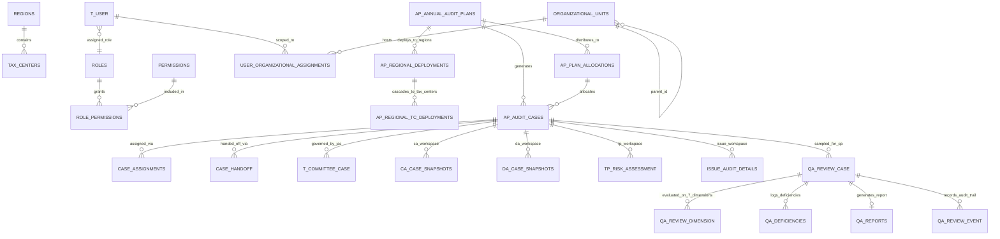
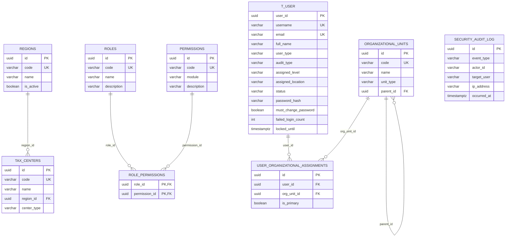
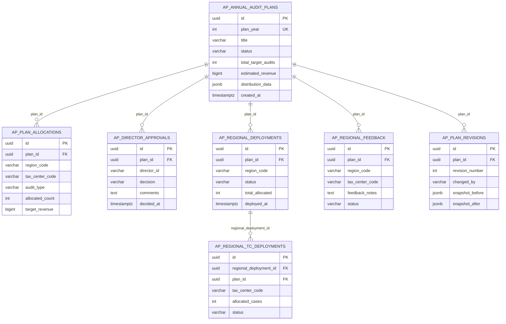
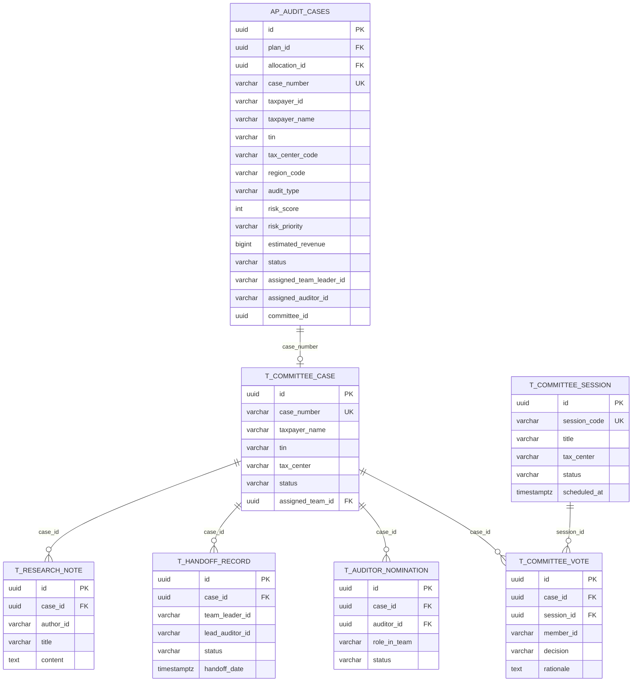
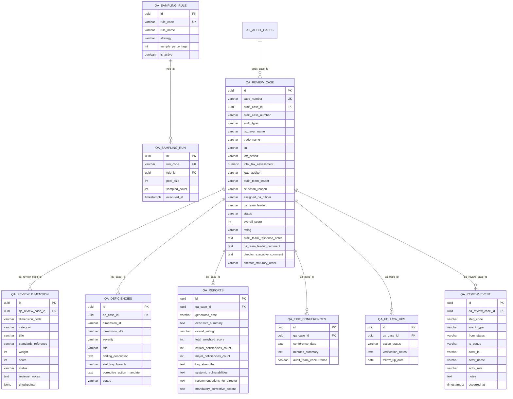

# ITAS Tax Audit System — Complete Entity-Relationship (ER) Diagrams

This document contains the complete Entity-Relationship (ER) diagrams for the Ethiopian Ministry of Revenues (MOR) **Integrated Tax Audit System (ITAS)** database (`itas_audit`, **124 tables**, **1,729 columns**, **103 foreign keys**, **327 indexes**).

---

## 1. Master Core Enterprise ER Diagram (Cross-Cluster Backbone)

---

## 2. Domain 1: Identity, RBAC, Security & Organizational Hierarchy

---

## 3. Domain 2: Annual Audit Planning & Regional/Tax-Center Cascade (`ap_*`)

---

## 4. Domain 3: Case Management, Joint Audit Committee (JAC) & Handoff

---

## 5. Domain 4: Comprehensive Audit (`ca_*`) & Desk Audit (`da_*`) Execution

```mermaid
erDiagram
    AP_AUDIT_CASES ||--o{ CA_ENTRY_CONFERENCES : "audit_case_id"
    AP_AUDIT_CASES ||--o{ CA_CAAT_ELIGIBILITY : "audit_case_id"
    AP_AUDIT_CASES ||--o{ CA_CAAT_RUNS : "audit_case_id"
    CA_CAAT_RUNS ||--o{ CA_CAAT_EXCEPTIONS : "caat_run_id"
    AP_AUDIT_CASES ||--o{ CA_BENFORD_ANALYSIS : "audit_case_id"
    AP_AUDIT_CASES ||--o{ CA_RECONCILIATIONS : "audit_case_id"
    AP_AUDIT_CASES ||--o{ CA_SAMPLING_RECORDS : "audit_case_id"
    AP_AUDIT_CASES ||--o{ CA_AUDIT_FINDINGS : "audit_case_id"
    AP_AUDIT_CASES ||--o{ CA_WORKING_PAPERS : "audit_case_id"
    AP_AUDIT_CASES ||--o{ CA_QUERY_SHEETS : "audit_case_id"
    AP_AUDIT_CASES ||--o{ CA_DRAFT_REPORTS : "audit_case_id"
    AP_AUDIT_CASES ||--o{ CA_EXIT_CONFERENCES : "audit_case_id"
    AP_AUDIT_CASES ||--o{ CA_ASSESSMENT_NOTICES : "audit_case_id"
    AP_AUDIT_CASES ||--o| CA_CASE_SNAPSHOTS : "case_id"

    AP_AUDIT_CASES ||--o{ DA_AUDIT_PROCEDURES : "audit_case_id"
    AP_AUDIT_CASES ||--o{ DA_EVIDENCE : "audit_case_id"
    AP_AUDIT_CASES ||--o{ DA_FINDINGS : "audit_case_id"
    AP_AUDIT_CASES ||--o{ DA_WORKING_PAPERS : "audit_case_id"
    AP_AUDIT_CASES ||--o{ DA_QUERIES : "audit_case_id"
    AP_AUDIT_CASES ||--o{ DA_DRAFT_REPORTS : "audit_case_id"
    AP_AUDIT_CASES ||--o| DA_CASE_SNAPSHOTS : "case_id"
```

---

## 6. Domain 5: Transfer Pricing (`tp_*`) & Issue Audit (`issue_*`) Execution

```mermaid
erDiagram
    AP_AUDIT_CASES ||--o{ TP_PHASE_GATES : "audit_case_id"
    AP_AUDIT_CASES ||--o{ TP_RISK_ASSESSMENT : "audit_case_id"
    AP_AUDIT_CASES ||--o{ TP_WORKING_HYPOTHESIS : "audit_case_id"
    AP_AUDIT_CASES ||--o{ TP_PLANNING_MEETING : "audit_case_id"
    AP_AUDIT_CASES ||--o{ TP_AUDIT_PLAN : "audit_case_id"
    AP_AUDIT_CASES ||--o{ TP_FIELD_WORK_DATA : "audit_case_id"
    AP_AUDIT_CASES ||--o{ TP_INFORMATION_REQUEST_LOG : "audit_case_id"
    AP_AUDIT_CASES ||--o{ TP_EXTERNAL_PRICE_MATCH : "audit_case_id"
    AP_AUDIT_CASES ||--o{ TP_COMPETITOR_PRICE_UPLOADS : "audit_case_id"
    AP_AUDIT_CASES ||--o{ TP_ANALYSIS_DATA : "audit_case_id"
    AP_AUDIT_CASES ||--o{ TP_EXIT_CONFERENCE : "audit_case_id"
    AP_AUDIT_CASES ||--o{ TP_AUDIT_REPORT : "audit_case_id"
    AP_AUDIT_CASES ||--o{ TP_AUDIT_NOTICE : "audit_case_id"
    AP_AUDIT_CASES ||--o{ TP_OBJECTION : "audit_case_id"
    AP_AUDIT_CASES ||--o{ TP_AUDIT_ACTION_HISTORY : "audit_case_id"
    AP_AUDIT_CASES ||--o| ISSUE_AUDIT_DETAILS : "audit_case_id"
```

---

## 7. Domain 6: Audit Quality Assurance & ISO-19011 Review (`qa_*`)

