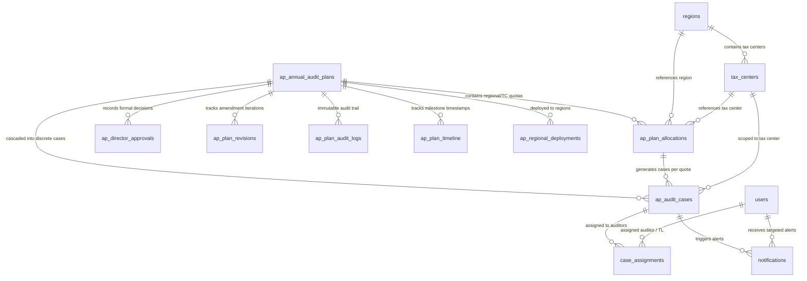

# Technical Presentation Guide: Database Schema & Data Dictionary Deep-Dive

**Audience**: Database Administrators (DBAs), Data Architects, Security Auditors, and Senior Backend Developers  
**Database**: PostgreSQL 15+ (`itas_audit`)  
**Schema**: `public`  
**Migration Tool**: Flyway (`V1__...` through `V26__...`)  
**Design Patterns**: Relational Integrity, Append-Only Audit Logging, JSONB Semi-Structured Data, Optimistic Locking

---

## 1. Relational Entity-Relationship (ER) Model



---

## 2. Table-by-Table Technical Catalog

---

### 2.1 `ap_annual_audit_plans` (Master Plan Entity)
- **Purpose**: Represents the top-level annual audit plan for a fiscal year.
- **Physical Storage**: PostgreSQL table with B-tree indexes and optimistic version lock.

| Column Name | Data Type | Nullable | Default | Description & Business Rules |
|---|---|---|---|---|
| `id` | `UUID` | **NOT NULL** | `gen_random_uuid()` | Primary Key (Synthetic UUID). |
| `plan_year` | `INTEGER` | **NOT NULL** | — | Fiscal year of the plan (e.g. `2026`). Must be $\ge 2024$. |
| `plan_name` | `VARCHAR(255)` | **NOT NULL** | — | Official title (e.g. "FY 2026 National Strategic Plan"). |
| `status` | `VARCHAR(64)` | **NOT NULL** | `'DRAFT'` | Current lifecycle status of the annual plan. |
| `total_cases` | `INTEGER` | **NOT NULL** | `0` | Aggregate target number of audits across all regions. |
| `estimated_revenue`| `NUMERIC(18,2)` | NULL | `0.00` | Projected tax collection / yield in Ethiopian Birr (ETB). |
| `version` | `INTEGER` | **NOT NULL** | `1` | Optimistic locking counter managed by Hibernate `@Version`. |
| `created_by` | `VARCHAR(64)` | **NOT NULL** | — | Actor ID who created the initial draft (`u-pt-01`). |
| `created_at` | `TIMESTAMPTZ` | **NOT NULL** | `CURRENT_TIMESTAMP` | System creation timestamp. |
| `updated_at` | `TIMESTAMPTZ` | **NOT NULL** | `CURRENT_TIMESTAMP` | Last modification timestamp. |

#### Allowed Lifecycle Status Transitions
```
DRAFT
  │
  ▼ (Submit to Director)
SUBMITTED_TO_DIRECTOR
  ├──► AMENDMENT_REQUESTED ──► REVISION_IN_PROGRESS ──► SUBMITTED_TO_DIRECTOR
  ├──► REJECTED
  │
  ▼ (Approve by Director)
DIRECTOR_APPROVED
  │
  ▼ (Distribute to Regions)
DISTRIBUTED_TO_REGIONS
  │
  ▼ (Divide into Tax Centers)
TAX_CENTERS_ALLOCATED
  │
  ▼ (All Feedback Recorded)
FEEDBACK_COMPLETE
  │
  ▼ (Finalize Plan)
FINALIZED
  │
  ▼ (Cascade to Cases Engine)
CASCADED_TO_CASES
```

---

### 2.2 `ap_plan_allocations` (Regional & Tax Center Quotas)
- **Purpose**: Stores regional quotas and branch-level tax center breakdowns per audit type.

| Column Name | Data Type | Nullable | Default | Description & Constraints |
|---|---|---|---|---|
| `id` | `UUID` | **NOT NULL** | `gen_random_uuid()` | Primary Key. |
| `plan_id` | `UUID` | **NOT NULL** | — | Foreign Key referencing `ap_annual_audit_plans(id)` ON DELETE CASCADE. |
| `region_code` | `VARCHAR(10)` | **NOT NULL** | — | Regional identifier (`FED`, `AA`, `BA`, `BB`, `AB`, `CA`, `SO`). |
| `tax_center_code` | `VARCHAR(64)` | NULL | — | Specific branch tax center (e.g. `TC-AA-01`). Null for regional-only quotas. |
| `audit_type` | `VARCHAR(32)` | NULL | — | Audit type: `DESK_AUDIT`, `FIELD_AUDIT`, `JOINT_AUDIT`, `TRANSFER_PRICING`, `COMPREHENSIVE_AUDIT`, `ISSUE_AUDIT`. |
| `proposed_count` | `INTEGER` | **NOT NULL** | `0` | Proposed audit count from Planning Officer / Risk Engine. |
| `allocated_count`| `INTEGER` | **NOT NULL** | `0` | Final agreed audit quota allocated to this unit. |
| `status` | `VARCHAR(32)` | **NOT NULL** | `'PROPOSED'` | Allocation state (`PROPOSED`, `ENDORSED`, `LOCKED`). |
| `created_at` | `TIMESTAMPTZ` | **NOT NULL** | `CURRENT_TIMESTAMP`| Audit creation timestamp. |

---

### 2.3 `ap_director_approvals` (Executive Sign-Off Records)
- **Purpose**: Stores formal approval or amendment decisions executed by the Director of Audit.

| Column Name | Data Type | Nullable | Description |
|---|---|---|---|
| `id` | `UUID` | **NOT NULL** | Primary Key. |
| `plan_id` | `UUID` | **NOT NULL** | FK to `ap_annual_audit_plans(id)`. |
| `director_id` | `VARCHAR(64)` | **NOT NULL** | Actor ID of the Director (`u-dir-audit`). |
| `decision` | `VARCHAR(32)` | **NOT NULL** | `APPROVED`, `REJECTED`, or `AMENDMENT_REQUESTED`. |
| `reason` | `TEXT` | NULL | Official rationale or strategic justification. |
| `approved_at` | `TIMESTAMPTZ` | **NOT NULL** | Exact timestamp of executive authorization. |

---

### 2.4 `ap_plan_revisions` (Amendment Iterations)
- **Purpose**: Captures revision iterations when a plan is returned to the Planning Team for adjustments.

| Column Name | Data Type | Nullable | Description |
|---|---|---|---|
| `id` | `UUID` | **NOT NULL** | Primary Key. |
| `plan_id` | `UUID` | **NOT NULL** | FK to `ap_annual_audit_plans(id)`. |
| `revision_number`| `INTEGER` | **NOT NULL** | Iteration round counter (`1`, `2`, ...). |
| `requested_by` | `VARCHAR(64)` | **NOT NULL** | Actor ID requesting amendment. |
| `requested_changes` | `JSONB` | **NOT NULL** | Structured JSON detailing requested regional/type adjustments. |
| `comments` | `TEXT` | NULL | Guidance instructions from Director. |
| `status` | `VARCHAR(32)` | **NOT NULL** | `OPEN`, `RESOLVED`, `SUPERSEDED`. |

---

### 2.5 `ap_audit_cases` (Cascaded Execution Cases)
- **Purpose**: The operational unit of tax audit work, instantiated when an annual plan quota is cascaded to real taxpayers.

| Column Name | Data Type | Nullable | Default | Description |
|---|---|---|---|---|
| `id` | `UUID` | **NOT NULL** | `gen_random_uuid()` | Case Primary Key. |
| `plan_id` | `UUID` | **NOT NULL** | — | FK to parent `ap_annual_audit_plans(id)`. |
| `allocation_id` | `UUID` | NULL | — | FK to originating `ap_plan_allocations(id)`. |
| `case_number` | `VARCHAR(64)` | **NOT NULL** | — | Unique statutory case identifier (e.g. `2026-841073e3-AA-TC-AA-03-0016`). |
| `taxpayer_id` | `VARCHAR(64)` | **NOT NULL** | — | Taxpayer Identification Number (TIN). |
| `taxpayer_name`| `VARCHAR(256)` | NULL | — | Registered enterprise legal name. |
| `sector` | `VARCHAR(128)` | NULL | — | Economic sector (Manufacturing, Trade, Finance, Mining). |
| `audit_type` | `VARCHAR(32)` | NULL | — | `DESK_AUDIT`, `COMPREHENSIVE_AUDIT`, `TRANSFER_PRICING`, etc. |
| `risk_score` | `INTEGER` | NULL | — | Computed compliance risk score (0 - 150). |
| `estimated_revenue`| `BIGINT` | NULL | — | Estimated annual turnover / gross receipts. |
| `status` | `VARCHAR(32)` | **NOT NULL** | `'PENDING_ASSIGNMENT'` | Case lifecycle status (`ASSIGNED`, `IN_PROGRESS`, `CLOSED`). |
| `tax_center_code`| `VARCHAR(64)` | NULL | — | Branch code responsible for audit execution (`TC-AA-03`). |
| `region_code` | `VARCHAR(10)` | NULL | — | Region code (`AA`, `FED`). |
| `assigned_team_leader_id`| `VARCHAR(64)` | NULL | — | Assigned supervisory Team Leader (`u-tl-01`). |
| `assigned_auditor_id` | `VARCHAR(64)` | NULL | — | Assigned Lead Auditor (`u-aud-01`). |
| `is_committee_case` | `BOOLEAN` | NULL | `false` | True for Joint Audit & Transfer Pricing cases requiring Committee oversight. |
| `tp_current_phase` | `VARCHAR(64)` | NULL | — | Transfer Pricing milestone phase (e.g. `FIELD_WORK`, `REPORT`, `ASSESSMENT`). |

#### Database Indexes on `ap_audit_cases`
```sql
CREATE UNIQUE INDEX ap_audit_cases_case_number_key ON ap_audit_cases(case_number);
CREATE INDEX idx_ap_audit_cases_plan_id ON ap_audit_cases(plan_id);
CREATE INDEX idx_ap_audit_cases_status ON ap_audit_cases(status);
CREATE INDEX idx_ap_audit_cases_tax_center ON ap_audit_cases(tax_center_code);
CREATE INDEX idx_ap_audit_cases_tc_status ON ap_audit_cases(tax_center_code, status);
CREATE INDEX idx_ap_audit_cases_team_leader ON ap_audit_cases(assigned_team_leader_id);
CREATE INDEX idx_ap_audit_cases_tl_status ON ap_audit_cases(assigned_team_leader_id, status);
CREATE INDEX idx_ap_audit_cases_auditor ON ap_audit_cases(assigned_auditor_id);
```

---

### 2.6 `notifications` (User-Targeted Real-Time Alerts)
- **Purpose**: Ensures that every workflow hand-off dispatches a notification stored directly in PostgreSQL, filtered strictly to the designated recipient user ID.

| Column Name | Data Type | Nullable | Description |
|---|---|---|---|
| `id` | `UUID` | **NOT NULL** | Notification ID. |
| `recipient_user_id`| `VARCHAR(64)`| **NOT NULL** | Target User ID (`u-dir-audit`, `u-tl-01`, `u-aud-01`). |
| `notification_type` | `VARCHAR(64)`| **NOT NULL** | Event code: `WORKFLOW_TASK`, `CASE_ASSIGNMENT`, `TP_PLAN_APPROVED`, `TP_REPORT_APPROVED`. |
| `title` | `VARCHAR(256)`| **NOT NULL** | Short summary header. |
| `body` | `TEXT` | **NOT NULL** | Full descriptive body text. |
| `artifact_type` | `VARCHAR(64)` | NULL | Referenced entity type (`AUDIT_PLAN`, `AUDIT_CASE`, `TP_REPORT`). |
| `artifact_id` | `UUID` | NULL | Referenced entity primary key. |
| `is_read` | `BOOLEAN` | **NOT NULL** | Read/unread flag (default `false`). |
| `read_at` | `TIMESTAMPTZ`| NULL | Timestamp when recipient opened alert. |
| `created_at` | `TIMESTAMPTZ`| **NOT NULL** | Notification creation timestamp. |

---

## 3. High-Value SQL Queries for Presentation & Verification

### 3.1 Verify Plan Status & Regional Quotas
```sql
SELECT 
    p.plan_year,
    p.plan_name,
    p.status AS plan_status,
    p.total_cases,
    a.region_code,
    SUM(a.allocated_count) AS regional_total
FROM ap_annual_audit_plans p
JOIN ap_plan_allocations a ON p.id = a.plan_id
WHERE p.plan_year = 2026
GROUP BY p.plan_year, p.plan_name, p.status, p.total_cases, a.region_code
ORDER BY regional_total DESC;
```

### 3.2 Audit Case Breakdown by Audit Type & Team Leader
```sql
SELECT 
    audit_type,
    tax_center_code,
    assigned_team_leader_id,
    COUNT(*) AS total_cases,
    SUM(estimated_revenue) AS total_revenue_at_risk
FROM ap_audit_cases
WHERE plan_id = (SELECT id FROM ap_annual_audit_plans ORDER BY created_at DESC LIMIT 1)
GROUP BY audit_type, tax_center_code, assigned_team_leader_id
ORDER BY total_cases DESC;
```

### 3.3 Verify User Notifications Audit Trail
```sql
SELECT 
    recipient_user_id,
    notification_type,
    title,
    is_read,
    created_at
FROM notifications
ORDER BY created_at DESC
LIMIT 10;
```

