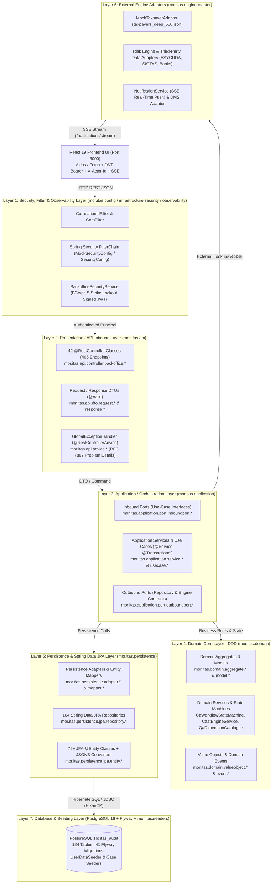
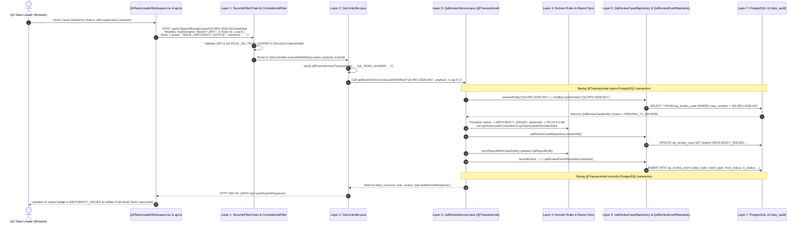

# ITAS Tax Audit System — Spring Boot Layered Architecture & End-to-End Code Flow Deep Dive

This document explains **how every layer of our Spring Boot backend (`bs-taxaudit-core-server`) works in code**, how a request flows from the React Frontend through each Spring Boot layer to PostgreSQL (`itas_audit`) and back, and provides real code examples from our actual project classes (`838` Java files, `42` Controllers, `104` JPA Repositories, and `124` PostgreSQL tables).

---

## 1. High-Level Architectural Pattern: Hybrid Hexagonal (Ports & Adapters) + Layered DDD

Our Spring Boot backend (`mor.itas`) combines **Enterprise Layered Architecture** with **Domain-Driven Design (DDD) & Hexagonal Architecture (Ports & Adapters)**. Every package under `src/main/java/mor/itas/` belongs to one of **7 clearly separated layers**:



---

## 2. Package-to-Layer Mapping in `backend/bs-taxaudit-core-server`

| Layer # | Layer Name | Exact Java Package(s) | Key Spring Annotations Used | Role in the System |
| :---: | :--- | :--- | :--- | :--- |
| **Layer 1** | **Security, Filters & Config** | `mor.itas.config`<br>`mor.itas.infrastructure.security`<br>`mor.itas.observability.filter` | `@Configuration`, `@EnableWebSecurity`, `@EnableMethodSecurity`, `@Component`, `@PostConstruct` | Intercepts every HTTP request, attaches correlation IDs, handles CORS, authenticates credentials/JWTs, and sets RBAC roles (`ROLE_*`) in `SecurityContextHolder`. |
| **Layer 2** | **API / Controller Layer** | `mor.itas.api.controller`<br>`mor.itas.api.dto.request`<br>`mor.itas.api.dto.response`<br>`mor.itas.api.mapper`<br>`mor.itas.api.advice` | `@RestController`, `@RequestMapping`, `@GetMapping`, `@PostMapping`, `@PutMapping`, `@DeleteMapping`, `@PreAuthorize`, `@Valid`, `@RestControllerAdvice` | Exposes the **406 REST endpoints**, validates incoming JSON payloads, extracts headers (`X-Actor-Id`, `Authorization`), delegates to Application Services/Use Cases, and formats HTTP responses. |
| **Layer 3** | **Application / Use-Case Layer** | `mor.itas.application.service`<br>`mor.itas.application.usecase`<br>`mor.itas.application.port`<br>`mor.itas.application.event` | `@Service`, `@Transactional`, `@RequiredArgsConstructor` | Orchestrates end-to-end business workflows inside a database transaction (`@Transactional`). Coordinates repositories, domain services, audit trails, and notifications. |
| **Layer 4** | **Domain Core Layer (DDD)** | `mor.itas.domain.aggregate`<br>`mor.itas.domain.model`<br>`mor.itas.domain.service`<br>`mor.itas.domain.valueobject`<br>`mor.itas.domain.event`<br>`mor.itas.domain.exception` | `@Service` (on pure domain services), Lombok `@Getter`, `@Builder` | Contains pure tax-audit business logic, statutory formulas (penalties, interest, ISO-19011 weighted scores, Benford's Law chi-square), and workflow state machines. |
| **Layer 5** | **Persistence / Repository Layer** | `mor.itas.persistence.adapter`<br>`mor.itas.persistence.jpa.repository`<br>`mor.itas.persistence.repository`<br>`mor.itas.persistence.jpa.entity`<br>`mor.itas.persistence.mapper` | `@Repository`, `@Entity`, `@Table`, `@Id`, `@Column`, `@OneToMany`, `@ManyToOne`, `@Query`, `@Converter` | Maps Java objects to the **124 PostgreSQL tables** via **104 Spring Data JPA repositories** and Hibernate 6 ORM (`HikariCP` connection pool). |
| **Layer 6** | **External Engine Adapters** | `mor.itas.engineadapter.*`<br>`mor.itas.infrastructure.*` | `@Component`, `@Profile("mock")` | Connects the core audit server to Taxpayer Registry (`MockTaxpayerAdapter`), Risk Engine, Third-Party Customs/Bank data, Document Management (DMS), and Server-Sent Events (SSE). |
| **Layer 7** | **Database & Bootstrap Seeders** | `src/main/resources/db/migration`<br>`mor.itas.seeders` | `@Component`, `CommandLineRunner`, `ApplicationRunner`, `@PostConstruct` | Manages the **41 Flyway SQL migrations** (`V0`–`V41`) and auto-seeds system users, organizations, plans, and audit cases on startup. |

---

## 3. Step-by-Step Deep Dive into Each Layer (With Real Project Code)

### Layer 1: Security, Filter & Observability Layer
**Files**:
- `mor.itas.config.MockSecurityConfig` / `SecurityConfig`
- `mor.itas.infrastructure.security.BackofficeSecurityService`
- `mor.itas.observability.filter.CorrelationIdFilter`

**How It Works**:
1. When the React frontend sends an HTTP request to `http://localhost:8080/api/v1/backoffice/...`, it first passes through `CorrelationIdFilter` (which attaches a trace UUID for logging) and Spring Security's `DefaultSecurityFilterChain`.
2. During login (`POST /api/v1/backoffice/auth/login`), `BackofficeSecurityService` resolves the user across all aliases (canonical username, legacy username, email, or UUID), verifies the BCrypt password hash, enforces the **5-attempt failed login lockout policy**, records a `SecurityAuditEvent`, and issues a signed HMAC-SHA256 JWT token.
3. On subsequent requests, the filter chain extracts the user's role (`AUDITOR`, `TEAM_LEADER`, `COMMITTEE_MEMBER`, `PLANNING_DIRECTOR`, `QA_OFFICER`, `QA_TEAM_LEADER`, `QA_DIRECTOR`, `SYSTEM_ADMIN`) so `@PreAuthorize("hasAnyRole(...)")` on controllers can enforce role-based access control.

```java
// Layer 1 Example: BackofficeSecurityService.java
public synchronized AuthResult authenticate(String identifier, String password, String ipAddress) {
    UserSecurityRecord rec = resolveUserRecord(identifier);
    if (rec == null) {
        recordAuditEvent("LOGIN_FAILED", "WARNING", identifier, identifier, "UNKNOWN", "UNKNOWN", ipAddress, "Unknown user identifier");
        return AuthResult.builder().success(false).httpStatus(401).message("Invalid username or password.").build();
    }
    if (!passwordEncoder.matches(password, rec.getPasswordHash())) {
        rec.setFailedLoginCount(rec.getFailedLoginCount() + 1);
        if (rec.getFailedLoginCount() >= MAX_FAILED_ATTEMPTS) {
            rec.setStatus("LOCKED");
            rec.setLockedUntil(OffsetDateTime.now().plusMinutes(LOCKOUT_MINUTES));
        }
        persistSecurityStateToDb(rec);
        return AuthResult.builder().success(false).httpStatus(401).remainingAttempts(MAX_FAILED_ATTEMPTS - rec.getFailedLoginCount()).build();
    }
    String token = generateSignedJwt(rec);
    return AuthResult.builder().success(true).httpStatus(200).token(token).user(toUserMap(rec)).build();
}
```

---

### Layer 2: Presentation / API Inbound Controller Layer (`mor.itas.api`)
**Files**:
- **42 Controllers** in `mor.itas.api.controller.backoffice.*` (e.g., `QaController`, `ComprehensiveAuditController`, `DeskAuditController`, `TpAuditExecutionController`, `PlanWorkflowController`, `CommitteeWorkspaceController`, `BackofficeAuthController`)
- **DTOs** in `mor.itas.api.dto.request.*` and `mor.itas.api.dto.response.*`
- **Exception Advice** in `mor.itas.api.advice.*`

**How It Works**:
- Controllers are thin HTTP adapters: they **never** talk directly to the database or write SQL.
- They bind path variables (`@PathVariable`), query parameters (`@RequestParam`), headers (`@RequestHeader("X-Actor-Id")`), and JSON bodies (`@Valid @RequestBody`), check `@PreAuthorize`, and delegate immediately to **Layer 3 (Application Service / Use Case)**.

```java
// Layer 2 Example: QaController.java
@RestController
@RequestMapping("/api/v1/backoffice/qa/cases")
@RequiredArgsConstructor
public class QaController {

    private final QaReviewService qaReviewService;

    @PutMapping("/{caseId}/dimensions/{dimId}")
    @PreAuthorize("hasAnyRole('AUDITOR', 'SENIOR_AUDITOR', 'TEAM_LEADER', 'AUDIT_MANAGER', 'QA_OFFICER', 'QA_TEAM_LEADER', 'QA_DIRECTOR', 'SYSTEM_ADMIN')")
    public ResponseEntity<Map<String, Object>> updateDimension(
            @PathVariable String caseId,
            @PathVariable String dimId,
            @RequestBody QaDimensionScoreRequest request,
            @RequestHeader(value = "X-Actor-Id", defaultValue = "u-qa-officer-1") String actorId) {
        return ResponseEntity.ok(qaReviewService.updateDimension(caseId, dimId, request, actorId));
    }
}
```

---

### Layer 3: Application / Orchestration Layer (`mor.itas.application`)
**Files**:
- **Application Services** (`mor.itas.application.service.*`): `QaReviewService`, `QaSamplingService`, `ComprehensiveAuditService`, `NotificationService`, etc.
- **Use Cases** (`mor.itas.application.usecase.*`): `TpFieldWorkUseCase`, `TpAnalysisUseCase`, `TpPlanningMeetingUseCase`, `TpWorkingHypothesisUseCase`, `DeskAuditUseCase`, `IssueAuditUseCase`, `PlanWorkflowUseCase`, etc.
- **Inbound & Outbound Ports** (`mor.itas.application.port.inboundport.*` & `outboundport.*`)

**How It Works**:
- Annotated with `@Service` and `@Transactional`.
- Starts a database transaction via Spring's `PlatformTransactionManager`.
- Loads entities/aggregates via **Layer 5 (Repositories / Outbound Ports)**, invokes **Layer 4 (Domain Services / State Machines)** to execute calculations or validate state transitions, saves updated state back to PostgreSQL, writes an immutable audit trail entry (`AuditTrailService` / `QaReviewEventRepository`), and triggers real-time notifications (`NotificationService`).
- If any runtime exception occurs inside the method, Spring automatically rolls back the entire PostgreSQL transaction.

```java
// Layer 3 Example: QaReviewService.java (@Service + @Transactional)
@Transactional
public Map<String, Object> updateDimension(String caseId, String dimId, QaDimensionScoreRequest request, String actorId) {
    // 1. Resolve parent aggregate/entity from Repository (Layer 5)
    QaReviewCaseEntity caseEntity = resolveEntity(caseId);
    ensureDimensionsExist(caseEntity);

    // 2. Load child dimension entity & apply updates
    QaReviewDimensionEntity target = qaReviewDimensionRepository
            .findByQaReviewCaseIdAndDimensionCode(caseEntity.getId(), dimId)
            .orElseThrow(() -> new IllegalArgumentException("Dimension not found: " + dimId));

    if (request.getScore() != null) target.setScore(request.getScore());
    if (request.getStatus() != null) target.setStatus(request.getStatus());
    if (request.getReviewerNotes() != null) target.setReviewerNotes(request.getReviewerNotes());
    qaReviewDimensionRepository.save(target);

    // 3. Invoke Domain Calculation Logic (Layer 4) — Recalculate ISO-19011 Weighted Score & Rating
    List<QaReviewDimensionEntity> allDims = qaReviewDimensionRepository
            .findByQaReviewCaseIdOrderByDisplayOrderAsc(caseEntity.getId());
    int newOverallScore = calculateWeightedScore(allDims);
    String newRating = computeRating(newOverallScore);

    // 4. Persist parent case & sync formal QA Report (Layer 5)
    caseEntity.setOverallScore(newOverallScore);
    caseEntity.setRating(newRating);
    qaReviewCaseRepository.save(caseEntity);
    syncReportWithCase(caseEntity);

    // 5. Record immutable Audit Trail Event
    recordEvent(caseEntity.getId(), "FR-04.9.2-05", "SCORE_DIMENSION",
            caseEntity.getStatus(), caseEntity.getStatus(), actorId, "QA_OFFICER",
            "Updated dimension " + dimId + " score to " + target.getScore() + "%");

    return Map.of("dimension", mapToDimensionResponse(target), "overallScore", newOverallScore, "rating", newRating);
}
```

---

### Layer 4: Domain Core Layer — Aggregates, State Machines & Calculation Engines (`mor.itas.domain`)
**Files**:
- **Aggregates**: `CaAuditCaseAggregate`, `AnnualPlanAggregate` (`mor.itas.domain.aggregate.*`)
- **Domain Services**: `CaWorkflowStateMachine`, `CaatEngineService`, `AssessmentNoticeGeneratorService`, `QaDimensionCatalogue` (`mor.itas.domain.service.*`)
- **Domain Models & Value Objects**: `mor.itas.domain.model.*`, `mor.itas.domain.valueobject.*`
- **Domain Exceptions**: `mor.itas.domain.exception.*`

**How It Works**:
- Encapsulates **pure tax audit domain rules** free of HTTP or UI concerns:
  - **Workflow State Machines** (`CaWorkflowStateMachine`, TP Phase Gates, QA Workflow Transitions): Enforces valid state transitions (e.g., an audit cannot move to `ASSESSMENT_ISSUED` before `EXIT_CONFERENCE` and `TL_APPROVAL`).
  - **CAAT & Statistical Engines** (`CaatEngineService`): Computes **Benford's Law first-digit chi-square ($\chi^2$) distributions**, Z-score anomaly detection, and 3-way/5-way cross-reconciliations (`VAT vs. CIT`, `PAYE vs. Payroll`, `ASYCUDA Customs CIF vs. GL Purchases`).
  - **Statutory Assessment & QA Scoring Catalogues** (`AssessmentNoticeGeneratorService`, `QaDimensionCatalogue`): Calculates Ethiopian Tax Administration Proclamation No. 983/2016 penalties/interest and ISO-19011 weighted quality scores across the 7 canonical QA dimensions (`DIM-01` through `DIM-07`).

---

### Layer 5: Persistence Adapter & Spring Data JPA Layer (`mor.itas.persistence`)
**Files**:
- **104 JPA Repositories** in `mor.itas.persistence.jpa.repository.*` and `mor.itas.persistence.repository.*`
- **75+ JPA Entities** in `mor.itas.persistence.jpa.entity.*` (`ap.*`, `ca.*`, `da.*`, `tp.*`, `qa.*`, `identity.*`, `issue.*`, `workflow.*`)
- **Persistence Adapters & Mappers** in `mor.itas.persistence.adapter.*` and `mor.itas.persistence.mapper.*`
- **JSONB Converters** in `mor.itas.persistence.jpa.converter.*`

**How It Works**:
1. **In Hexagonal Modules (e.g., Annual Planning `ap` & Transfer Pricing `tp`)**:
   - The Use Case calls an Outbound Port interface (e.g., `TpFieldWorkRepositoryPort`), which is implemented by a `@Component` Persistence Adapter (`TpFieldWorkPersistenceAdapter`). The adapter uses a Mapper (`TpFieldWorkMapper`) to convert between the pure Domain Model and the JPA `@Entity`, then calls the Spring Data `JpaRepository`.
2. **In Direct Service Modules (e.g., Comprehensive Audit `ca` & Quality Assurance `qa`)**:
   - The Application Service calls the Spring Data `JpaRepository` interface directly (e.g., `ApAuditCaseRepository`, `QaReviewCaseRepository`, `CaCaseSnapshotRepository`), which Hibernate 6 translates into parameterized SQL queries over the `HikariCP` connection pool to PostgreSQL (`itas_audit`).

```java
// Layer 5 Example: QaReviewDimensionEntity.java (JPA Entity with PostgreSQL JSONB mapping)
@Entity
@Table(name = "qa_review_dimension")
@Getter @Setter @NoArgsConstructor @AllArgsConstructor @Builder
public class QaReviewDimensionEntity {
    @Id
    @GeneratedValue(strategy = GenerationType.UUID)
    private UUID id;

    @Column(name = "qa_review_case_id", nullable = false)
    private UUID qaReviewCaseId;

    @Column(name = "dimension_code", nullable = false, length = 32)
    private String dimensionCode; // DIM-01 .. DIM-07

    @Column(nullable = false)
    private Integer weight; // e.g., 15, 20

    @Column(nullable = false)
    private Integer score;  // 0 - 100

    @JdbcTypeCode(SqlTypes.JSON)
    @Column(columnDefinition = "jsonb")
    private List<Map<String, Object>> checkpoints; // Stored as native PostgreSQL JSONB
}
```

---

### Layer 6: External Engine Adapters (`mor.itas.engineadapter`)
**Files**:
- `mor.itas.engineadapter.taxpayer.MockTaxpayerAdapter`
- `mor.itas.engineadapter.usermanagement.MockUserManagementAdapter`
- `mor.itas.engineadapter.riskengine.*`
- `mor.itas.engineadapter.thirdpartydata.*`
- `mor.itas.application.service.notification.NotificationService`

**How It Works**:
- Provides clean adapter boundaries for external government and tax systems so the core audit server can run standalone in `mock` profile (using rich embedded datasets like `taxpayers_deep_550.json`) or connect to external microservices in production.
- Includes `NotificationService`, which maintains active **Server-Sent Events (`SseEmitter`)** channels (`/api/v1/backoffice/notifications/stream`) to push real-time workflow alerts to the React UI whenever a plan, committee vote, case handoff, or QA review changes state.

---

### Layer 7: Database & Bootstrap Seeding Layer (`db/migration` + `mor.itas.seeders`)
**Files**:
- `src/main/resources/db/migration/V0__shared_infrastructure.sql` through `V41__ca_case_snapshots.sql`
- `mor.itas.seeders.UserDataSeeder`
- `mor.itas.application.service.qa.QaReviewService.ensureInitialQaCasesSeeded()`

**How It Works**:
- **Flyway Migrations (`V0`–`V41`)** define the **124 PostgreSQL tables**, **103 foreign keys**, and **327 indexes**.
- On application startup, `UserDataSeeder` (`ApplicationRunner`) and `BackofficeSecurityService` (`@PostConstruct`) synchronize all **95+ MOR user accounts** (including `SYSTEM_ADMIN`, `PLANNING_DIRECTOR`, `COMMITTEE_MEMBER`, `TEAM_LEADER`, `AUDITOR`, `QA_OFFICER`, `QA_TEAM_LEADER`, and `QA_DIRECTOR`) into the PostgreSQL `t_user` table so every role can log in immediately.

---

## 4. Complete End-to-End Request Flow Trace (Concrete Walkthrough)

Below is a complete trace showing what happens in code when a **QA Team Leader (`Tewodros Mekonnen`)** clicks **"Issue Deficiency Notice to Field Audit Team"** in the React UI:



---

## 5. Summary Comparison of Our Two Internal Implementation Styles

In `bs-taxaudit-core-server`, you will see two complementary patterns inside Layers 2–5 depending on the cluster:

| Aspect | Pattern A: Strict Hexagonal Use-Case Pattern<br>*(Used in `ap`, `tp`, `da`, `issue`, `workflow`)* | Pattern B: Rich Application-Service Pattern<br>*(Used in `ca`, `qa`, `jac`, `auth`)* |
| :--- | :--- | :--- |
| **Controller (`Layer 2`)** | Calls an Inbound Port / `@Service` Use Case (`TpFieldWorkUseCase`, `PlanWorkflowUseCase`) | Calls a `@Service` Application Service (`ComprehensiveAuditService`, `QaReviewService`) |
| **Application (`Layer 3`)** | `*UseCase.java` orchestrates Domain Models and calls `*RepositoryPort` interfaces | `*Service.java` (`@Transactional`) orchestrates Domain Services (`CaatEngineService`, `QaDimensionCatalogue`) and JPA Repositories |
| **Persistence (`Layer 5`)** | `*PersistenceAdapter.java` implements `*RepositoryPort`, uses `*Mapper.java` to convert Domain Model <-> JPA `@Entity`, and calls `*JpaRepository` | `*Service.java` calls Spring Data `*Repository` directly and maps `@Entity` <-> `*Response` DTOs |
| **Database (`Layer 7`)** | Persists to PostgreSQL (`ap_*`, `tp_*`, `da_*`, `issue_*`) | Persists to PostgreSQL (`ca_*`, `qa_*`, `t_committee_*`, `t_user`) |
