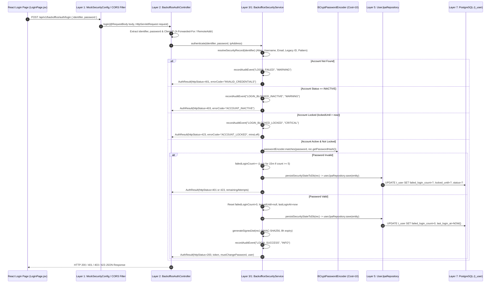

# ITAS Tax Audit System — Backend Login, Authentication & Security Code Flow

This document provides a **complete, line-by-line code walkthrough** of how user login, BCrypt password verification, brute-force account lockout, forced password change, and signed HMAC-SHA256 JWT issuance work on the Spring Boot backend (`bs-taxaudit-core-server`).

---

## 1. End-to-End Login Sequence Across Spring Boot Layers



---

## 2. Exact Backend Source Files Involved in Login

| Layer | Class / File | Responsibility |
| :--- | :--- | :--- |
| **Layer 1 (Filter & CORS)** | [`MockSecurityConfig.java`](file:///home/paul/itas-audit-system/backend/bs-taxaudit-core-server/src/main/java/mor/itas/config/MockSecurityConfig.java) | Configures stateless `SessionCreationPolicy.STATELESS`, disables CSRF for REST APIs, and exposes `Authorization` & `X-Actor-Id` CORS headers. |
| **Layer 2 (REST Controller)** | [`BackofficeAuthController.java`](file:///home/paul/itas-audit-system/backend/bs-taxaudit-core-server/src/main/java/mor/itas/api/controller/backoffice/ap/BackofficeAuthController.java) | Exposes `POST /api/v1/backoffice/auth/login`, `/change-password`, `/me`, and `/admin/*` endpoints. |
| **Layer 3 (Security Service)** | [`BackofficeSecurityService.java`](file:///home/paul/itas-audit-system/backend/bs-taxaudit-core-server/src/main/java/mor/itas/infrastructure/security/BackofficeSecurityService.java) | Core engine for user alias resolution, BCrypt hashing, 5-attempt lockout, password complexity validation, DB state sync, and HMAC-SHA256 JWT signing. |
| **Layer 5 (JPA Repository)** | [`UserJpaRepository.java`](file:///home/paul/itas-audit-system/backend/bs-taxaudit-core-server/src/main/java/mor/itas/persistence/jpa/repository/ap/UserJpaRepository.java) | Spring Data JPA interface querying `t_user` by `username` or `email`. |
| **Layer 5 (JPA Entity)** | [`UserEntity.java`](file:///home/paul/itas-audit-system/backend/bs-taxaudit-core-server/src/main/java/mor/itas/persistence/jpa/entity/ap/UserEntity.java) | Maps the PostgreSQL `t_user` table including security columns (`password_hash`, `must_change_password`, `failed_login_count`, `locked_until`, `last_login_at`, `password_changed_at`). |
| **Layer 7 (Flyway SQL)** | [`V37__user_security_columns.sql`](file:///home/paul/itas-audit-system/backend/bs-taxaudit-core-server/src/main/resources/db/migration/V37__user_security_columns.sql) | Adds the security columns to `t_user` in PostgreSQL. |

---

## 3. Step-by-Step Code Walkthrough

### Step 1: Startup Initialization & Multi-Source User Synchronization (`@PostConstruct`)
When the Spring Boot application starts, [`BackofficeSecurityService.init()`](file:///home/paul/itas-audit-system/backend/bs-taxaudit-core-server/src/main/java/mor/itas/infrastructure/security/BackofficeSecurityService.java#L128-L163) runs automatically:
1. It pre-computes the BCrypt cost-10 hash for the default initial password (`Mor@2026!`).
2. It merges users from all 4 sources (`MockUserManagementAdapter`, `MockUserRepository`, PostgreSQL `t_user` table via `UserJpaRepository`, and frontend seed aliases including `SYSTEM_ADMIN` and `QA_OFFICER`/`QA_TEAM_LEADER`/`QA_DIRECTOR`) without overwriting custom passwords already saved in PostgreSQL.

```java
// File: BackofficeSecurityService.java
private final BCryptPasswordEncoder passwordEncoder = new BCryptPasswordEncoder(10);

public static final String DEFAULT_INITIAL_PASSWORD = "Mor@2026!";
public static final int MAX_FAILED_ATTEMPTS = 5;
public static final int LOCKOUT_DURATION_MINUTES = 15;
private static final long JWT_EXPIRY_SECONDS = 8 * 3600L; // 8 hours max token lifetime

@PostConstruct
public void init() {
    this.defaultPasswordHash = passwordEncoder.encode(DEFAULT_INITIAL_PASSWORD);
    synchronizeAllExistingUsers();
    recordAuditEvent("SYSTEM_SECURITY_INIT", "INFO", "SYSTEM", "ALL_USERS", "SYSTEM_ADMIN", "FEDERAL", "127.0.0.1",
            "MOR Back-Office BCrypt Password Engine, 5-attempt Lockout Guard, and Signed JWT Service initialized (" + securityRecords.size() + " accounts protected).");
}
```

---

### Step 2: Controller Receives the HTTP `POST /api/v1/backoffice/auth/login` Request
When the user clicks **Sign In** on the React frontend, [`BackofficeAuthController.login()`](file:///home/paul/itas-audit-system/backend/bs-taxaudit-core-server/src/main/java/mor/itas/api/controller/backoffice/ap/BackofficeAuthController.java#L25-L50) extracts the `identifier` (which can be `identifier`, `username`, or `email`), the `password`, and the client's IP address, then delegates to `securityService.authenticate(...)`:

```java
// File: BackofficeAuthController.java (Lines 25-50)
@PostMapping("/login")
public ResponseEntity<Map<String, Object>> login(
        @RequestBody Map<String, Object> body,
        HttpServletRequest request) {
    String identifier = body.get("identifier") != null
            ? body.get("identifier").toString()
            : (body.get("username") != null ? body.get("username").toString() : (body.get("email") != null ? body.get("email").toString() : ""));
    String password = body.get("password") != null ? body.get("password").toString() : "";
    String ipAddress = extractClientIp(request);

    AuthResult result = securityService.authenticate(identifier, password, ipAddress);

    Map<String, Object> response = new LinkedHashMap<>();
    response.put("success", result.isSuccess());
    response.put("message", result.getMessage());
    if (result.getErrorCode() != null) response.put("errorCode", result.getErrorCode());
    if (result.getRemainingAttempts() != null) response.put("remainingAttempts", result.getRemainingAttempts());
    if (result.getLockedUntil() != null) response.put("lockedUntil", result.getLockedUntil());
    if (result.isSuccess()) {
        response.put("token", result.getToken());
        response.put("expiresIn", result.getExpiresIn());
        response.put("mustChangePassword", result.isMustChangePassword());
        response.put("user", result.getUser());
    }
    return ResponseEntity.status(result.getHttpStatus()).body(response);
}
```

---

### Step 3: Strict Multi-Alias User Resolution (`resolveSecurityRecord`)
Users in MOR ITAS can log in using their **canonical username** (`u-tl-fed1a`), **email** (`abebe.bikila@mor.gov.et`), **short alias** (`abebe.bikila` or `admin`), or **legacy ID** (`usr-qa-01`). [`BackofficeSecurityService.resolveSecurityRecord()`](file:///home/paul/itas-audit-system/backend/bs-taxaudit-core-server/src/main/java/mor/itas/infrastructure/security/BackofficeSecurityService.java#L387-L420) resolves registered accounts strictly without synthesizing unknown usernames/emails:

```java
// File: BackofficeSecurityService.java
public UserSecurityRecord resolveSecurityRecord(String identifier) {
    if (identifier == null || identifier.isBlank()) return null;
    String clean = identifier.trim().toLowerCase();
    String base = clean.replace("@mor.gov.et", "");

    String canonical = aliasToCanonicalId.get(clean);
    if (canonical == null) canonical = aliasToCanonicalId.get(base);
    if (canonical != null && securityRecords.containsKey(canonical)) {
        return securityRecords.get(canonical);
    }

    for (UserSecurityRecord rec : securityRecords.values()) {
        if (rec.getUsername().equalsIgnoreCase(clean)
                || rec.getUsername().equalsIgnoreCase(base)
                || (rec.getEmail() != null && rec.getEmail().equalsIgnoreCase(clean))
                || (rec.getLegacyId() != null && rec.getLegacyId().equalsIgnoreCase(clean))) {
            return rec;
        }
    }

    // Strictly reject any unrecognized username or email
    return null;
}
```

---

### Step 4: Account Status & Brute-Force Lockout Checks (`authenticate`)
Inside [`BackofficeSecurityService.authenticate()`](file:///home/paul/itas-audit-system/backend/bs-taxaudit-core-server/src/main/java/mor/itas/infrastructure/security/BackofficeSecurityService.java#L455-L515), before checking the password, the backend enforces two security gates:
1. **Deactivated Account Check (`HTTP 403 ACCOUNT_INACTIVE`)**: If a System Admin deactivated the account (`status == "INACTIVE"`), login is immediately rejected.
2. **Brute-Force Lockout Check (`HTTP 423 ACCOUNT_LOCKED`)**: If the user previously had 5 failed attempts and `now.isBefore(rec.getLockedUntil())`, login is blocked with the exact number of minutes remaining. Once the 15-minute window expires, the account automatically unlocks.

```java
// File: BackofficeSecurityService.java
// 1. Check if account is deactivated by System Admin
if ("INACTIVE".equalsIgnoreCase(rec.getStatus())) {
    recordAuditEvent("LOGIN_BLOCKED_INACTIVE", "WARNING", rec.getUsername(), rec.getUsername(), rec.getUserType(), rec.getAssignedLocation(), ipAddress,
            "Blocked login attempt on deactivated account.");
    return AuthResult.builder()
            .success(false)
            .httpStatus(403)
            .errorCode("ACCOUNT_INACTIVE")
            .message("Your MOR account has been deactivated. Please contact the System Administrator.")
            .build();
}

// 2. Check if account is currently locked due to brute-force attempts
OffsetDateTime now = OffsetDateTime.now();
if (rec.getLockedUntil() != null) {
    if (now.isBefore(rec.getLockedUntil())) {
        long minsLeft = Math.max(1, ChronoUnit.MINUTES.between(now, rec.getLockedUntil()) + 1);
        recordAuditEvent("LOGIN_BLOCKED_LOCKED", "CRITICAL", rec.getUsername(), rec.getUsername(), rec.getUserType(), rec.getAssignedLocation(), ipAddress,
                "Blocked login attempt while account is locked (" + minsLeft + " min remaining).");
        return AuthResult.builder()
                .success(false)
                .httpStatus(423)
                .errorCode("ACCOUNT_LOCKED")
                .lockedUntil(rec.getLockedUntil())
                .message("Account is locked due to " + MAX_FAILED_ATTEMPTS + " failed password attempts. Try again in " + minsLeft + " minute(s) or contact the MOR System Administrator.")
                .build();
    } else {
        // Lockout window expired -> auto-unlock
        rec.setLockedUntil(null);
        rec.setFailedLoginCount(0);
        if ("LOCKED".equalsIgnoreCase(rec.getStatus())) {
            rec.setStatus("ACTIVE");
        }
    }
}
```

---

### Step 5: BCrypt Password Verification & Failed-Attempt Counter (`authenticate`)
Next, [`BackofficeSecurityService.authenticate()`](file:///home/paul/itas-audit-system/backend/bs-taxaudit-core-server/src/main/java/mor/itas/infrastructure/security/BackofficeSecurityService.java#L517-L565) verifies the password using `BCryptPasswordEncoder.matches(rawPassword, passwordHash)`:
- Unmodified accounts only accept the official initial default password (`Mor@2026!`). Legacy passwords like `password123` are strictly rejected. Once the user changes their password (`customPasswordSet = true`), only their personal BCrypt hash is accepted.
- If the password is wrong, `failedLoginCount` is incremented and persisted to PostgreSQL (`t_user`). On the **5th failed attempt**, `status` is set to `"LOCKED"`, `lockedUntil` is set to `now.plusMinutes(15)`, and `HTTP 423` is returned:

```java
// File: BackofficeSecurityService.java
// 3. Verify Password using BCrypt (strictly verify against stored BCrypt hash; legacy password123 is NOT accepted)
boolean passwordValid = passwordEncoder.matches(password, rec.getPasswordHash());
if (!passwordValid && !rec.isCustomPasswordSet()) {
    // Allow only the current initial default password (Mor@2026!) on unmodified accounts
    if (DEFAULT_INITIAL_PASSWORD.equals(password)) {
        passwordValid = true;
    }
}

if (!passwordValid) {
    int fails = rec.getFailedLoginCount() + 1;
    rec.setFailedLoginCount(fails);
    int remaining = Math.max(0, MAX_FAILED_ATTEMPTS - fails);

    if (fails >= MAX_FAILED_ATTEMPTS) {
        OffsetDateTime lockUntil = now.plusMinutes(LOCKOUT_DURATION_MINUTES);
        rec.setLockedUntil(lockUntil);
        rec.setStatus("LOCKED");
        persistSecurityStateToDb(rec);

        recordAuditEvent("ACCOUNT_LOCKED", "CRITICAL", rec.getUsername(), rec.getUsername(), rec.getUserType(), rec.getAssignedLocation(), ipAddress,
                "Account automatically locked for " + LOCKOUT_DURATION_MINUTES + " minutes after " + fails + " consecutive failed password attempts.");

        return AuthResult.builder()
                .success(false)
                .httpStatus(423)
                .errorCode("ACCOUNT_LOCKED")
                .remainingAttempts(0)
                .lockedUntil(lockUntil)
                .message("Account locked for " + LOCKOUT_DURATION_MINUTES + " minutes after " + MAX_FAILED_ATTEMPTS + " failed password attempts. Contact System Admin to unlock.")
                .build();
    }

    persistSecurityStateToDb(rec);
    recordAuditEvent("LOGIN_FAILED", "WARNING", rec.getUsername(), rec.getUsername(), rec.getUserType(), rec.getAssignedLocation(), ipAddress,
            "Invalid password entered (Attempt " + fails + " of " + MAX_FAILED_ATTEMPTS + ").");

    return AuthResult.builder()
            .success(false)
            .httpStatus(401)
            .errorCode("INVALID_CREDENTIALS")
            .remainingAttempts(remaining)
            .message("Invalid username/email or password. Warning: " + remaining + " attempt(s) remaining before account lockout.")
            .build();
}
```

---

### Step 6: Successful Login, PostgreSQL Persistence & Signed HMAC-SHA256 JWT Generation
When the password matches:
1. `failedLoginCount` is reset to `0`, `lockedUntil` is cleared, and `lastLoginAt` is updated to `OffsetDateTime.now()`.
2. [`persistSecurityStateToDb(rec)`](file:///home/paul/itas-audit-system/backend/bs-taxaudit-core-server/src/main/java/mor/itas/infrastructure/security/BackofficeSecurityService.java#L899-L939) writes the updated security state into the PostgreSQL `t_user` table via `UserJpaRepository`.
3. [`generateSignedJwt(rec)`](file:///home/paul/itas-audit-system/backend/bs-taxaudit-core-server/src/main/java/mor/itas/infrastructure/security/BackofficeSecurityService.java#L993-L1021) creates an RFC-compliant `HS256` JWT containing the user's `sub` (`userId`), `username`, `email`, `fullName`, `role` (`userType`), `assignedLevel`, `taxCenter` (`assignedLocation`), `auditType`, `iat`, and `exp` (8 hours), and signs it with `HmacSHA256`:

```java
// File: BackofficeSecurityService.java (Lines 608-630 & 993-1021)
// 4. Successful Authentication -> Reset failed attempts, update lastLoginAt, generate signed JWT
rec.setFailedLoginCount(0);
rec.setLockedUntil(null);
if ("LOCKED".equalsIgnoreCase(rec.getStatus())) {
    rec.setStatus("ACTIVE");
}
rec.setLastLoginAt(now);
persistSecurityStateToDb(rec);

String jwtToken = generateSignedJwt(rec);
recordAuditEvent("LOGIN_SUCCESS", "INFO", rec.getUsername(), rec.getUsername(), rec.getUserType(), rec.getAssignedLocation(), ipAddress,
        "Successful back-office authentication (" + rec.getFullName() + " — " + rec.getUserType() + ").");

return AuthResult.builder()
        .success(true)
        .httpStatus(200)
        .message("Authentication successful")
        .token(jwtToken)
        .expiresIn(JWT_EXPIRY_SECONDS)
        .mustChangePassword(rec.isMustChangePassword())
        .user(toUserMap(rec))
        .build();
```

And the JWT signing method:
```java
// File: BackofficeSecurityService.java (Lines 993-1021)
public String generateSignedJwt(UserSecurityRecord rec) {
    long nowSec = System.currentTimeMillis() / 1000L;
    long expSec = nowSec + JWT_EXPIRY_SECONDS;

    String headerJson = "{\"alg\":\"HS256\",\"typ\":\"JWT\"}";
    String payloadJson = String.format(
            "{\"sub\":\"%s\",\"username\":\"%s\",\"email\":\"%s\",\"fullName\":\"%s\",\"role\":\"%s\",\"assignedLevel\":\"%s\",\"taxCenter\":\"%s\",\"auditType\":\"%s\",\"iat\":%d,\"exp\":%d}",
            escapeJson(rec.getUserId()),
            escapeJson(rec.getUsername()),
            escapeJson(rec.getEmail()),
            escapeJson(rec.getFullName()),
            escapeJson(rec.getUserType()),
            escapeJson(rec.getAssignedLevel()),
            escapeJson(rec.getAssignedLocation()),
            escapeJson(rec.getAuditType()),
            nowSec,
            expSec
    );

    String headerB64 = Base64.getUrlEncoder().withoutPadding().encodeToString(headerJson.getBytes(StandardCharsets.UTF_8));
    String payloadB64 = Base64.getUrlEncoder().withoutPadding().encodeToString(payloadJson.getBytes(StandardCharsets.UTF_8));
    String signingInput = headerB64 + "." + payloadB64;
    String signatureB64 = signHmacSha256(signingInput);
    return signingInput + "." + signatureB64;
}
```

---

### Step 7: Password Change & Character Policy Enforcement (`POST /api/v1/backoffice/auth/login` -> `/change-password`)
When a user changes their password (either voluntarily or when `mustChangePassword == true` after a System Admin reset), [`BackofficeSecurityService.changePassword()`](file:///home/paul/itas-audit-system/backend/bs-taxaudit-core-server/src/main/java/mor/itas/infrastructure/security/BackofficeSecurityService.java#L636-L714) validates the exact password written by the user against MOR's 5-rule character policy, hashes the new password with BCrypt, clears `mustChangePassword`, saves to PostgreSQL `t_user`, and returns a fresh signed JWT:

```java
// File: BackofficeSecurityService.java (Lines 698-714)
public void validatePasswordStrength(String password, String username) {
    if (password == null || password.length() < 8) {
        throw new IllegalArgumentException("Password must be at least 8 characters long.");
    }
    if (!java.util.regex.Pattern.compile("[A-Z]").matcher(password).find()) {
        throw new IllegalArgumentException("Password must contain at least one uppercase letter (A-Z).");
    }
    if (!java.util.regex.Pattern.compile("[a-z]").matcher(password).find()) {
        throw new IllegalArgumentException("Password must contain at least one lowercase letter (a-z).");
    }
    if (!java.util.regex.Pattern.compile("[0-9]").matcher(password).find()) {
        throw new IllegalArgumentException("Password must contain at least one digit (0-9).");
    }
    if (!java.util.regex.Pattern.compile("[^A-Za-z0-9\\s]").matcher(password).find()) {
        throw new IllegalArgumentException("Password must contain at least one special character (e.g. @, !, #, $).");
    }
}
```
