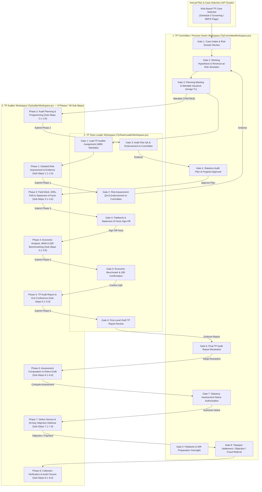

# ITAS Tax Audit System — Transfer Pricing (TP) Workspace End-to-End Deep Dive

This document provides the **complete, end-to-end technical, functional, and statutory reference** for the **Transfer Pricing (TP) Audit Cluster** (`BUC-TA-013` through `BUC-TA-018`) in the Ethiopian Ministry of Revenues (MoR) ITAS Tax Audit System. It covers the multi-role workspaces, the 8 strict governance phase gates, all 48 granular auditor sub-steps, the econometric and tax adjustment formulas, the Spring Boot backend architecture, all 54 REST API endpoints, and the 15 PostgreSQL database tables.

---

## 1. Executive Overview & Statutory Framework

Transfer Pricing audits examine **international and domestic controlled transactions** between associated enterprises (parent companies, offshore holding hubs, IP boxes, treasury centers, and domestic Special Economic Zone / Industrial Park affiliates) to verify compliance with the **Arm's Length Principle (ALP)**.

### Governing Legal & Regulatory Authority
- **Income Tax Proclamation No. 979/2016 (Article 79)**: Authorizes the Ministry of Revenues to distribute, apportion, or allocate income, deductions, or credits between related parties so that taxable income reflects the arm's length return.
- **Tax Administration Proclamation No. 983/2016**:
  - **Article 23 & 78**: Mandatory written Notice of Audit prior to fieldwork.
  - **Article 27**: Statutory 5-year assessment limitation bar (extended to 10 years for fraud/evasion).
  - **Article 45 & 46**: Statutory Transfer Pricing documentation (Master File & Local File) and Information & Document Request (IDR) powers.
  - **Article 80**: Mandatory Exit Conference prior to final assessment.
  - **Article 98 & 99**: Statutory Assessment Notice, 30-day objection countdown, and mandatory 25% disputed tax deposit requirement (`Art. 99(2)`).
  - **Article 104 & 105**: Statutory late payment interest and under-declaration penalties (`20%` standard / `50%` substantial or deliberate non-compliance).
- **MoR Transfer Pricing Directive No. 43/2015**: Defines the 5 approved TP methods (`CUP`, `RPM`, `CPM`, `TNMM`, `PSM`), comparability factors, Interquartile Range (`IQR`) median adjustment rules, and Schedule 5 annual disclosure requirements (for controlled transactions exceeding `ETB 500,000`).
- **OECD Transfer Pricing Guidelines & BEPS Actions 8–10, 13**:
  - **5-Step Intra-Group Service Benefit Test** (Real service rendered, commercial benefit, arm's length charge, non-duplication, exclusion of shareholder/stewardship costs).
  - **DEMPE Intangibles Framework** (Development, Enhancement, Maintenance, Protection, Exploitation).

---

## 2. Multi-Role Workspace Architecture & Separation of Duties

The Transfer Pricing cluster enforces **strict statutory separation of duties** across three dedicated role workspaces on the frontend and role-verified phase gates on the backend (`Auditors` are blocked with `HTTP 403 Forbidden` from reviewing or approving their own phase gates, plans, or reports).

### Frontend Source Files Mapping

| Component / File | Role / Audience | Primary Responsibility |
| :--- | :--- | :--- |
| [`TpAuditorWorkspace.jsx`](file:///home/paul/itas-audit-system/frontend/back-office-ui/src/features/tp/pages/TpAuditorWorkspace.jsx) | **TP Auditor** (`AUDITOR`) | Full 8-phase, 48-sub-step execution console with phase gate locking, real-time PostgreSQL auto-save, IDR modal, and phase submission modal. |
| [`TpTeamLeaderWorkspace.jsx`](file:///home/paul/itas-audit-system/frontend/back-office-ui/src/features/tp/pages/TpTeamLeaderWorkspace.jsx) | **TP Team Leader** (`TEAM_LEADER`) | 6-gate supervisory workbench: auditor assignment, 5-point verification checklists, endorsement to Committee, revision return, Fact Statement sign-off, and IQR confirmation. |
| [`TpCommitteeWorkspace.jsx`](file:///home/paul/itas-audit-system/frontend/back-office-ui/src/features/tp/pages/TpCommitteeWorkspace.jsx) | **TP Committee / Process Owner** (`COMMITTEE`, `PROCESS_OWNER`) | 8-gate executive governance workbench: intake acceptance, live Revenue-at-Risk calculator, planning meeting mandate, plan approval, report resolution, and statutory notice sign-off. |
| [`TpAuditWorkspace.jsx`](file:///home/paul/itas-audit-system/frontend/back-office-ui/src/features/tp/pages/TpAuditWorkspace.jsx) | **Unified / Multi-Role Deep View** | Comprehensive 5-sub-page enterprise stepper per phase with OECD 5-Step Benefit Test matrix, DEMPE matrix, multi-year base erosion tables, and statutory notice preview. |
| [`tpSubStepConfigs.js`](file:///home/paul/itas-audit-system/frontend/back-office-ui/src/features/tp/data/tpSubStepConfigs.js) | **Configuration Schema** | Defines the 8 `AUDITOR_PHASES` and all 48 `PHASE_SUB_STEPS` (`1.1` to `8.6`) with statutory guidance and approving authorities. |
| [`Phase1SubSteps.jsx`](file:///home/paul/itas-audit-system/frontend/back-office-ui/src/features/tp/components/substeps/Phase1SubSteps.jsx) – [`Phase8SubSteps.jsx`](file:///home/paul/itas-audit-system/frontend/back-office-ui/src/features/tp/components/substeps/Phase8SubSteps.jsx) | **Interactive Sub-Step Forms** | Dedicated interactive forms, calculators, and checklists for each of the 8 phases. |
| [`PhaseGateLockScreen.jsx`](file:///home/paul/itas-audit-system/frontend/back-office-ui/src/features/tp/components/PhaseGateLockScreen.jsx) | **Gate Enforcement UI** | Blocks access to Phase $N$ until Phase $N-1$ is formally `APPROVED` in `tp_phase_gates`. |
| [`PhaseReviewBanner.jsx`](file:///home/paul/itas-audit-system/frontend/back-office-ui/src/features/tp/components/PhaseReviewBanner.jsx) | **Review Status Banner** | Displays live gate status (`DRAFT`, `SUBMITTED_FOR_REVIEW`, `SUBMITTED_FOR_COMMITTEE`, `REVISION_REQUESTED`, `APPROVED`) and reviewer comments. |
| [`PhaseSubmissionModal.jsx`](file:///home/paul/itas-audit-system/frontend/back-office-ui/src/features/tp/components/PhaseSubmissionModal.jsx) | **Dossier Submission Modal** | Validates that all 6 sub-steps in a phase are completed before submitting the phase dossier to the Team Leader or Committee. |

### Official TP Login Accounts for Testing & Demonstration
*(Default Password for all initial accounts: **`Mor@2026!`**)*

| Role | Login Email / Identifier | Alternative Username | Full Name | Tax Center |
| :--- | :--- | :--- | :--- | :--- |
| **TP Committee Chair** | `u-com-federal-lto1-tp-chair@mor.gov.et` | `u-com-federal-lto1-tp-chair` | TP Committee Chair (FED-LTO1) | Federal LTO-1 |
| **TP Committee Member** | `u-com-federal-lto1-tp-mem1@mor.gov.et` | `u-com-federal-lto1-tp-mem1` | TP Committee Member 1 | Federal LTO-1 |
| **TP Team Leader** | `u-tl-federal-lto1-tp-1@mor.gov.et` | `u-tl-federal-lto1-tp-1` | Workneh Kassa | Federal LTO-1 |
| **TP Senior Auditor** | `u-aud-federal-lto1-tp-1-1@mor.gov.et` | `u-aud-federal-lto1-tp-1-1` | Tadesse Mamo | Federal LTO-1 |

---

## 3. End-to-End Walkthrough of the 8 Phases & 48 Sub-Steps (Auditor Workspace)

Every Transfer Pricing case in [`TpAuditorWorkspace.jsx`](file:///home/paul/itas-audit-system/frontend/back-office-ui/src/features/tp/pages/TpAuditorWorkspace.jsx) progresses sequentially through **8 strict governance phases**. Each phase contains **6 mandatory sub-steps** (`48 sub-steps` total). A phase remains locked behind [`PhaseGateLockScreen.jsx`](file:///home/paul/itas-audit-system/frontend/back-office-ui/src/features/tp/components/PhaseGateLockScreen.jsx) until the preceding phase gate is approved.

---

### Phase 1: Detailed Risk Assessment & Evidence (`DETAILED_RISK_ASSESSMENT`)
- **UI Component**: [`Phase1SubSteps.jsx`](file:///home/paul/itas-audit-system/frontend/back-office-ui/src/features/tp/components/substeps/Phase1SubSteps.jsx)
- **Approving Authority**: `TP Team Leader` $\rightarrow$ `TP Review Committee`
- **Database Table**: `tp_risk_assessment` & `tp_working_hypothesis`
- **What the Auditor Does Across the 6 Sub-Steps**:
  1. **`1.1 Related Party Transaction Scoping`**: Extracts and verifies **Schedule 5** annual TP disclosures, cross-border parent/subsidiary contracts, and domestic SEZ affiliate transactions:
     - *International Streams*: e.g., Management & Technical Services (`Mauritius`, `TNMM`, `CRITICAL`), Raw Material Imports (`Singapore`, `CUP`, `MEDIUM`), Trademark & Brand Royalties (`Switzerland`, `CUT`, `HIGH`), Intercompany Financing (`Netherlands`, `CUP`, `MONITORED`).
     - *Domestic Streams*: e.g., Finished Fabric Sales to tax-exempt Industrial Park affiliate (`Hawassa SEZ — 10-Yr CIT Holiday`, `TNMM`, `CRITICAL`), Domestic Machinery Lease (`CUP`, `MEDIUM`).
  2. **`1.2 Financial Ratio & Operating Margin Profiling`**: Profiles 5-year and 10-year audited financial statements (`FY 2020 – FY 2024`), tracking Turnover growth against declining Gross Margin (`19.8%` $\rightarrow$ `14.8%`), declining EBIT Margin (`3.1%` $\rightarrow$ `1.5%`), and continuous Net Losses (`-1.2M` $\rightarrow$ `-6.4M ETB`) to detect systematic profit suppression.
  3. **`1.3 Risk Flag & BEPS Factor Matrix`**: Scores 10 weighted BEPS Action 8–10 risk indicators (total weight = `100`):
     - Operating Margin Below Benchmark (`15 pts`), Continuous 3-Year Net Losses (`15 pts`), High Management Fee to Revenue Ratio (`15 pts`), Payments to Low-Tax Jurisdiction (`15 pts`), Thin Capitalization Debt/Equity > 2:1 (`10 pts`), Intangible IP Royalty Transfer (`10 pts`), Customs Import Price Inflation (`10 pts`), Year-End Credit Memos (`5 pts`), Unhedged FX Risk Transfer (`3 pts`), Local File Deficiency (`2 pts`).
  4. **`1.4 Preliminary Materiality Calculation`**: Computes preliminary planning materiality (`1.0%` of gross turnover = `ETB 5,000,000`) and tolerable deviation (`ETB 3,500,000`), plus Revenue-at-Risk simulation across open tax years.
  5. **`1.5 Taxpayer Evidence Dossier Assembly`**: Catalogs statutory documentation under Article 45 (Master File, Local File, Audited Financial Statements, Customs Declarations, Intercompany Agreements).
  6. **`1.6 Risk Assessment Summary & Recommendation`**: Assigns overall risk level (`LOW`, `MEDIUM`, `HIGH`, `CRITICAL`) and submits the Phase 1 dossier (`POST /phases/DETAILED_RISK_ASSESSMENT/submit`) to the TP Team Leader.

---

### Phase 2: Audit Planning & Programming (`AUDIT_PLANNING` — `BUC-TA-013`)
- **UI Component**: [`Phase2SubSteps.jsx`](file:///home/paul/itas-audit-system/frontend/back-office-ui/src/features/tp/components/substeps/Phase2SubSteps.jsx)
- **Approving Authority**: `TP Team Leader` (Endorsement) $\rightarrow$ `TP Review Committee / Process Owner` (Final Approval)
- **Database Table**: `tp_audit_plan` & `tp_planning_meeting`
- **What the Auditor Does Across the 6 Sub-Steps**:
  1. **`2.1 Audit Scope & Tax Periods Definition`**: Defines the 5-year statutory audit window (`FY 2020 – FY 2024`) under Article 27 of Proclamation 983/2016 (or 10-year extended fraud window) and locks the covered controlled transaction streams.
  2. **`2.2 Quantitative Materiality & Sampling Thresholds`**: Finalizes Planning Materiality (`ETB 5,000,000`), Tolerable Misstatement (`ETB 3,500,000`), and Stratified Sampling parameters (`Population: 1,420 transactions`, `Sample Size: 85 transactions`, `100% examination of transactions > 1M ETB`).
  3. **`2.3 Industry & Market Comparability Research`**: Documents industry sector structure (`Textile & Garment Manufacturing`), regulatory caps (e.g., National Bank of Ethiopia foreign service fee ceilings), and pricing structures.
  4. **`2.4 Audit Program & Timetable Formulation`**: Allocates audit resources (`480 man-hours` over `90 statutory days`) across Lead Auditor, TP Team Leader, Senior TP Economist, and Legal Counsel, and defines specific step-by-step audit procedures.
  5. **`2.5 Taxpayer Engagement & Notice of Audit`**: Drafts and dispatches the statutory **Notice of Audit** under Article 23/78 (at least 15 working days before on-site fieldwork) with attached **IDR-01** initial document checklist.
  6. **`2.6 Formal Entry Conference Conduct & Minutes`**: Records the Entry Conference (`POST /entry-conference`) held with taxpayer executives and external tax counsel, capturing venue, delegation roster, agenda, and signed minutes.

---

### Phase 3: Field Work & Statement of Facts (`FIELD_WORK` — `BUC-TA-014`)
- **UI Component**: [`Phase3SubSteps.jsx`](file:///home/paul/itas-audit-system/frontend/back-office-ui/src/features/tp/components/substeps/Phase3SubSteps.jsx)
- **Approving Authority**: `TP Team Leader` (Statement of Facts Sign-Off)
- **Database Table**: `tp_field_work_data` & `tp_information_request_log`
- **What the Auditor Does Across the 6 Sub-Steps**:
  1. **`3.1 Information Document Request (IDR) Log`**: Issues formal, reference-numbered IDRs (`IDR-TP-*` via `POST /field-work/idr/create` or `/field-work/information-requests/create`) for technical agreements, employee activity timesheets, and CbCR data; tracks 14/15-day statutory deadlines, overdue flags, and taxpayer document responses (`POST /field-work/idr/{idrId}/respond`).
  2. **`3.2 Functional Analysis (FAR — Functions)`**: Maps operational decision-making, R&D, procurement, manufacturing, and distribution functions between the Ethiopian entity and foreign affiliates to determine accurate entity characterization (e.g., *Routine Contract Manufacturer* vs. *Entrepreneur*).
  3. **`3.3 Asset Utilization & DEMPE Verification`**: Evaluates tangible machinery vs. high-value trade/marketing intangibles across the **DEMPE matrix** (*Development, Enhancement, Maintenance, Protection, Exploitation*), verifying whether the Ethiopian entity bears local commercialization costs without owning the IP.
  4. **`3.4 Risk Allocation & Assumption Assessment`**: Evaluates contractual vs. economic assumption of market risk, inventory obsolescence, credit risk, and foreign exchange risk, plus verifies the **OECD 5-Step Intra-Group Service Benefit Test**.
  5. **`3.5 On-Site Operational Inspection & Personnel Interviews`**: Logs plant tour observations (`POST /field-work/site-visit`), SAP S/4HANA General Ledger & cost-center accounting assessments (`POST /field-work/accounting`), transaction audit trails (`85 traced`, `68 supported`, `17 questioned`), and structured interview minutes with plant/finance managers.
  6. **`3.6 Formal Statement of Facts Compilation`**: Compiles the versioned **Statement of Facts** (`POST /field-work/fact-statement`), records taxpayer observations, and submits Phase 3 to the **TP Team Leader** for formal `TL_SIGNED_OFF` approval (or triggers Alternative Flow `AF1: No Risk Found` via `POST /field-work/no-risk` if transactions are fully arm's length).

---

### Phase 4: Economic Analysis, Benchmarking & IQR (`ANALYSIS` — `BUC-TA-015`)
- **UI Component**: [`Phase4SubSteps.jsx`](file:///home/paul/itas-audit-system/frontend/back-office-ui/src/features/tp/components/substeps/Phase4SubSteps.jsx)
- **Approving Authority**: `TP Team Leader` / `TP Committee`
- **Database Table**: `tp_analysis_data`, `tp_competitor_price_uploads`, `tp_external_price_match`
- **What the Auditor Does Across the 6 Sub-Steps**:
  1. **`4.1 Most Appropriate Method (MAM) Selection`**: Screens all 5 statutory TP methods (`CUP`, `Resale Price`, `Cost Plus`, `TNMM`, `Profit Split`) under Directive No. 43/2015, documenting formal justification for the selected primary method (`TNMM`) and rejection reasons for inapplicable methods (`POST /analysis/method-selection`).
  2. **`4.2 Tested Party Identification`**: Designates the least complex functional entity with reliable segmented financial data (the Ethiopian operating subsidiary) as the Tested Party.
  3. **`4.3 Profit Level Indicator (PLI) Selection`**: Selects and computes the appropriate PLI (`Operating Margin = EBIT / Sales`, `Berry Ratio`, `Return on Total Costs`) and compares multi-year taxpayer ratios against industry benchmarks (`POST /analysis/ratios`).
  4. **`4.4 Comparable Search, Competitor Price Upload & Customs Matching`**:
     - Documents the econometric database search strategy (`Bureau van Dijk Orbis / MoR Sector Study`, `14 independent comparables`).
     - Uploads competitor import prices (`POST /analysis/competitor-prices`) and runs automated **ASYCUDA Customs Valuation Discrepancy Matching** (`POST /analysis/competitor-prices/run-discrepancy`) by Harmonized System (`HS`) code, flagging any import price variance exceeding the `5.0%` threshold in `tp_external_price_match`.
  5. **`4.5 Economic & Working Capital Adjustments`**: Applies accounting reclassifications and working capital adjustments (receivables, inventory, payables) using commercial prime interest rates to neutralize financing differences.
  6. **`4.6 Interquartile Range (IQR) & Median Adjustment Calculation`**:
     - Computes the Arm's Length Interquartile Range (`POST /analysis/recalculate` & `POST /analysis/arms-length`):
       $$\text{Q1 (25th Percentile)} = 4.80\%, \quad \text{Median (50th Percentile)} = 6.40\%, \quad \text{Q3 (75th Percentile)} = 8.20\%$$
     - Under **Article 79 & Directive No. 43/2015**, because the taxpayer's actual EBIT margin (`1.50%`) falls below `Q1` (`4.80%`), the taxable profit base is adjusted to the **Median (`6.40%`)**:
       $$\text{Variance \%} = 6.40\% - 1.50\% = 4.90\%$$
       $$\text{Income Tax Base Adjustment} = \text{ETB } 575,000,000 \times 4.90\% = \text{ETB } 28,175,000$$
     - (Alternative Flow `AF3`: If the taxpayer's result falls inside `[Q1, Q3]`, the auditor invokes `POST /analysis/arms-length-confirmed` to confirm compliance with zero adjustment.)

---

### Phase 5: TP Audit Report & Exit Conference (`REPORT` — `BUC-TA-016`)
- **UI Component**: [`Phase5SubSteps.jsx`](file:///home/paul/itas-audit-system/frontend/back-office-ui/src/features/tp/components/substeps/Phase5SubSteps.jsx)
- **Approving Authority**: `TP Team Leader` (First-Level QA) $\rightarrow$ `TP Review Committee / Process Owner` (Final Resolution)
- **Database Table**: `tp_audit_report` & `tp_exit_conference`
- **What the Auditor Does Across the 6 Sub-Steps**:
  1. **`5.1 Comprehensive TP Audit Report Drafting`**: Drafts the versioned TP Audit Report (`POST /report/draft`) consolidating Executive Summary, Audit Background, Scope, FAR Findings, Economic Benchmarking, Legal Grounds, and Proposed Tax Adjustments.
  2. **`5.2 Draft Report Supervisory Review`**: Submits the draft report (`POST /report/{reportId}/submit-for-team-leader-review`) to the TP Team Leader for internal technical and legal QA review before engaging the taxpayer.
  3. **`5.3 Formal Exit Conference Convening`**: Schedules and convenes the mandatory **Exit Conference** under Article 80 (`tp_exit_conference`). By statutory rule enforced in schema `V15`, the venue must be the **MoR Tax Office** (never at the taxpayer's premises).
  4. **`5.4 Exit Conference Minutes & Attendance`**: Records auditor notes, taxpayer verbal observations, agreed adjustments, and taxpayer e-signature (`POST /exit-conference/record`).
  5. **`5.5 Taxpayer Written Rebuttal Evaluation`**: Records and evaluates the taxpayer's post-conference written rebuttal (`POST /report/{reportId}/taxpayer-response`) or escalates deliberate bogus invoicing to the Criminal Investigation Division (`POST /report/{reportId}/escalate-fraud` — `AF5`).
  6. **`5.6 Final Audit Findings Endorsement Dossier`**: Submits the finalized report dossier (`POST /phases/REPORT/submit`) for **TP Committee Resolution Approval** (`POST /report/{reportId}/committee-approval`).

---

### Phase 6: Assessment Computation & Statutory Notice Draft (`ASSESSMENT` — `BUC-TA-017`)
- **UI Component**: [`Phase6SubSteps.jsx`](file:///home/paul/itas-audit-system/frontend/back-office-ui/src/features/tp/components/substeps/Phase6SubSteps.jsx)
- **Approving Authority**: `Audit Director & TP Process Owner / Committee`
- **Database Table**: `tp_audit_notice`
- **What the Auditor Does Across the 6 Sub-Steps**:
  1. **`6.1 Tax Base Adjustment Computation`**: Computes multi-year additional Corporate Income Tax (`30% CIT`) on profit shortfall/disallowed deductions and Withholding Tax (`15% WHT`) on re-characterized offshore management/royalty payments (`Assessed Principal Tax`).
  2. **`6.2 Statutory Penalties Calculation`**: Computes under-declaration penalties under **Article 105** of Proclamation 983/2016 (`20%` standard or `50%` substantial transfer pricing non-compliance).
  3. **`6.3 Statutory Late Interest Calculation`**: Computes compounded statutory interest under **Article 104** from the original tax return due dates to the assessment date.
     $$\text{Total Assessment Amount} = \text{Assessed Principal Tax} + \text{Statutory Penalties} + \text{Statutory Late Interest}$$
  4. **`6.4 Statutory Assessment Notice Drafting`**: Generates the formal **Statutory Notice of Assessment** (`NOT-TP-*` via `POST /notice/generate` and `POST /assessment/save`) citing legal provisions, bank remittance accounts, and the 30-day payment/objection window under Article 98.
  5. **`6.5 Legal & Compliance Verification`**: Verifies absence of procedural defects, statute-of-limitation compliance, and official service address.
  6. **`6.6 Submission for Authorized Official Signature`**: Submits Phase 6 for executive digital authorization (`POST /notice/authorize`) by the **TP Review Committee / Process Owner**.

---

### Phase 7: Notice Service, 30-Day Countdown & Objection (`NOTICE` — `BUC-TA-018`)
- **UI Component**: [`Phase7SubSteps.jsx`](file:///home/paul/itas-audit-system/frontend/back-office-ui/src/features/tp/components/substeps/Phase7SubSteps.jsx)
- **Approving Authority**: `Objection Review Authority / TP Committee`
- **Database Table**: `tp_audit_notice` & `tp_objection`
- **What the Auditor Does Across the 6 Sub-Steps**:
  1. **`7.1 Formal Notice Service & Proof of Delivery`**: Dispatches the authorized notice (`POST /notice/{noticeId}/dispatch`) via Electronic Portal, Registered Mail, or Hand Delivery, confirms delivery (`POST /notice/{noticeId}/acknowledge`), or logs undelivered returns (`POST /notice/{noticeId}/returned` — `AF1`), initiating the **30-day statutory countdown** under Article 99.
  2. **`7.2 Taxpayer Payment / Objection Ingestion`**: Tracks whether the taxpayer:
     - **Accepts & Settles** (`POST /assessment/taxpayer-accept` $\rightarrow$ `SETTLED_ACCEPTED`),
     - **Files a Formal Objection** within 30 days after paying the mandatory **25% deposit of disputed tax** under `Article 99(2)` (`POST /assessment/taxpayer-object`), or
     - **Defaults** after 30 days (`POST /assessment/default-enforce` $\rightarrow$ `ENFORCEMENT_COLLECTION_REFERRED` for bank lien/asset seizure).
  3. **`7.3 Objection Grounds Legal & Technical Dissection`**: Dissects each contested point in `tp_objection` (comparable screening, working capital adjustment, benefit test evidence, penalty relief).
  4. **`7.4 Auditor Technical Defense Rejoinder`**: Prepares the point-by-point technical defense rejoinder backing the MoR interquartile range and factual findings.
  5. **`7.5 Objection Review Session / Reconciliation Hearing`**: Presents the audit dossier before the Tax Decision / Review Committee.
  6. **`7.6 Final Administrative Determination Recording`**: Records the Review Committee's administrative ruling (`UPHELD`, `AMENDED`, or `REJECTED` via `POST /objection/record` and `POST /objections/{objectionId}/review`).

---

### Phase 8: Collection Verification & Audit Closure (`CLOSURE` — `BUC-TA-018`)
- **UI Component**: [`Phase8SubSteps.jsx`](file:///home/paul/itas-audit-system/frontend/back-office-ui/src/features/tp/components/substeps/Phase8SubSteps.jsx)
- **Approving Authority**: `TP Team Leader & Audit Director / Process Owner`
- **Database Table**: `ap_audit_cases`, `tp_phase_gates`, `tp_audit_action_history`
- **What the Auditor Does Across the 6 Sub-Steps**:
  1. **`8.1 Collection Order & Revenue Remittance Verification`**: Matches SIGTAS/ITAS payment receipt numbers and bank deposit slips against the final assessed principal, penalty, and interest.
  2. **`8.2 Tax Clearance / Audit Concluded Certificate`**: Generates the formal **Transfer Pricing Audit Concluded Certificate** for the audited tax periods (`FY 2020 – FY 2024`).
  3. **`8.3 Risk Profile & Machine Learning Update`**: Feeds verified profit-shifting patterns, tax-haven counterparties, and effective adjustment yields back into the national Risk Selection Engine.
  4. **`8.4 Lessons Learned & Directives Feedback`**: Logs technical recommendations for the MoR Transfer Pricing Policy Directorate.
  5. **`8.5 Complete Digital Audit Dossier Archival`**: Packages all 8 phases (risk matrix, plans, IDRs, FAR workpapers, Orbis IQR benchmarks, Exit Conference minutes, assessment notices, and objection rulings) into an immutable 10-year statutory archive.
  6. **`8.6 Final Supervisory Sign-Off & Case Status CONCLUDED`**: Invokes `POST /assessment/close-and-kpi` (and `POST /close`), updating case status to `COMPLETED`, marking the `CLOSURE` phase gate `APPROVED`, releasing allocated auditor hours, and updating executive KPI dashboards.

---

## 4. Deep Dive: TP Team Leader & TP Committee Workspaces

### 4.1 TP Team Leader Workspace ([`TpTeamLeaderWorkspace.jsx`](file:///home/paul/itas-audit-system/frontend/back-office-ui/src/features/tp/pages/TpTeamLeaderWorkspace.jsx))
The TP Team Leader acts as the **first-line quality assurance gatekeeper** between the Lead TP Auditor and the TP Review Committee across **6 Supervisory Gates**:

| Gate # | Gate ID | Supervisory Action & Built-In Controls | Backend Endpoint Invoked |
| :---: | :--- | :--- | :--- |
| **1** | `CASE_ASSIGNMENT` | Selects a specialized TP Auditor from the Tax Center roster and assigns the 480-hour execution mandate. | `POST /api/v1/backoffice/ap/cases/{caseId}/assign` |
| **2** | `RISK_REVIEW` | Completes a **5-Point Statutory Risk Checklist** (*Schedule 5 examined, 5-year statute verified, BEPS pillars substantiated, tax-haven transactions flagged, working hypothesis valid*) and either **Endorses to Committee** or **Requests Revision**. | `POST /phases/DETAILED_RISK_ASSESSMENT/review` (`ENDORSE_TO_COMMITTEE` or `REVISION_REQUESTED`) |
| **3** | `PLAN_REVIEW` | Completes a **5-Point Audit Plan Checklist** (*Scope within mandate, materiality adequate, MUS/stratified sampling compliant, entry conference protocol signed, man-hours reasonable*) and **Endorses to Committee** or **Requests Revision**. | `POST /phases/AUDIT_PLANNING/review` & `POST /audit-plan/tl-endorse` |
| **4** | `FACT_STATEMENT` | Reviews the Auditor's Fieldwork FAR analysis, IDR responses, and Statement of Facts, then grants formal **`TL_SIGNED_OFF`** approval to unlock Economic Analysis. | `POST /field-work/fact-statement` & `POST /phases/FIELD_WORK/review` (`APPROVED`) |
| **5** | `BENCHMARK_REVIEW` | Verifies the Most Appropriate Method (`MAM`), Tested Party, Orbis comparable screening, and Interquartile Range (`Q1 / Median / Q3`) computation. | `POST /phases/ANALYSIS/review` (`APPROVED`) |
| **6** | `REPORT_REVIEW` | Conducts first-level technical & legal QA review of the Draft TP Audit Report and Exit Conference minutes before routing to the Committee. | `POST /report/{reportId}/team-leader-review` & `POST /phases/REPORT/review` (`ENDORSE_TO_COMMITTEE`) |

---

### 4.2 TP Review Committee / Process Owner Workspace ([`TpCommitteeWorkspace.jsx`](file:///home/paul/itas-audit-system/frontend/back-office-ui/src/features/tp/pages/TpCommitteeWorkspace.jsx))
The TP Review Committee / Process Owner exercises **statutory executive authority** across **8 Governance Gates**:

| Gate # | Gate ID | Executive Governance Action & Live Simulators | Backend Endpoint Invoked |
| :---: | :--- | :--- | :--- |
| **1** | `INTAKE_REVIEW` | Reviews the case risk dossier from Annual Planning / Team Leader endorsement and formally accepts case intake into the TP pipeline. | `POST /accept-intake` |
| **2** | `WORKING_HYPOTHESIS` | Formulates the **Working Hypothesis** and runs the **Live Revenue-at-Risk Simulator**: • $\text{Profit Shortfall} = \text{Turnover} \times (\text{Benchmark Margin} - \text{Reported Margin})$ • $\text{CIT Delta} = 30\% \times \text{Profit Shortfall}$ • $\text{WHT Delta} = 15\% \times \text{Management Fees}$ • $\text{Penalty Delta} = 40\% \times (\text{CIT Delta} + \text{WHT Delta})$ • $\text{Total Revenue at Risk} = \text{CIT} + \text{WHT} + \text{Penalty}$ | `POST /working-hypothesis` & `POST /phases/DETAILED_RISK_ASSESSMENT/review` (`APPROVED`) |
| **3** | `PLANNING_MEETING` | Convening of the statutory TP Planning Meeting: records minutes, designates the **TP Team Leader**, sets target fiscal years & statutory deadline (`20 days`), and votes **`CONTINUE`** (issuing the Planning Mandate) or **`DISCONTINUE`**. | `POST /planning-meeting/decision` |
| **4** | `PLAN_APPROVAL` | Reviews the TL-endorsed Audit Plan (`Form FR-04.5.1`) and either grants **Statutory Approval** (unlocking Fieldwork), **Requests Plan Revision**, or orders **`AF2: Additional Industry Research`**. | `POST /audit-plan/approve`, `POST /audit-plan/request-revision`, or `POST /audit-plan/additional-research` |
| **5** | `PREPARATION_REVIEW` | Monitors active Fieldwork progress, reviews IDR logs, and approves sensitive Information Requests. | `POST /field-work/information-requests/{idrId}/approve` |
| **6** | `REPORT_APPROVAL` | Adopts the formal **Review Committee Resolution** approving the final TP Audit Report (`FULLY_APPROVED`), unlocking Phase 6 Assessment Computation. | `POST /report/{reportId}/committee-approval` |
| **7** | `NOTICE_AUTHORIZATION` | Legally signs and authorizes the **Official Statutory Assessment Notice (`NOT-TP-*`)** for formal dispatch to the taxpayer. | `POST /notice/authorize` & `POST /assessment/generate-final-notice` |
| **8** | `OBJECTION_FRAUD` | Records final post-notice outcomes: Taxpayer Settlement, Administrative Objection Determination, 30-Day Default Enforcement Referral, or Criminal Tax Fraud Referral (`Form FR-04.5-22`). | `POST /objection/record`, `POST /assessment/default-enforce`, `POST /notice/fraud-referral`, `POST /assessment/close-and-kpi` |

---

## 5. Spring Boot Backend Layer-by-Layer Architecture for Transfer Pricing

When any action is taken in the TP Workspace, the request flows through the 7 Spring Boot layers in `bs-taxaudit-core-server`:

1. **Layer 2 — REST Controllers**:
   - [`TpAuditExecutionController.java`](file:///home/paul/itas-audit-system/backend/bs-taxaudit-core-server/src/main/java/mor/itas/api/controller/backoffice/tp/TpAuditExecutionController.java): Handles all 8 phases, phase gate state transitions, role separation-of-duties checks, notifications, and action history logging (`42` endpoints).
   - [`TpEnhancedExecutionController.java`](file:///home/paul/itas-audit-system/backend/bs-taxaudit-core-server/src/main/java/mor/itas/api/controller/backoffice/tp/TpEnhancedExecutionController.java): Handles competitor import price uploads, ASYCUDA customs price discrepancy matching, granular IDR approval lifecycle, and phase-filtered audit action history (`12` endpoints).
2. **Layer 3 — Application Services & Use Cases**:
   - [`TpCaseInitializationService.java`](file:///home/paul/itas-audit-system/backend/bs-taxaudit-core-server/src/main/java/mor/itas/application/service/tp/TpCaseInitializationService.java): Automatically initializes complete, realistic PostgreSQL records (`tp_risk_assessment`, `tp_working_hypothesis`, `tp_audit_plan`, `tp_field_work_data`, `tp_analysis_data`, and all 8 `tp_phase_gates`) the first time a `TRANSFER_PRICING` case is opened.
   - [`TpRiskAssessmentUseCase.java`](file:///home/paul/itas-audit-system/backend/bs-taxaudit-core-server/src/main/java/mor/itas/application/usecase/tp/TpRiskAssessmentUseCase.java)
   - [`TpWorkingHypothesisUseCase.java`](file:///home/paul/itas-audit-system/backend/bs-taxaudit-core-server/src/main/java/mor/itas/application/usecase/tp/TpWorkingHypothesisUseCase.java)
   - [`TpAuditPlanUseCase.java`](file:///home/paul/itas-audit-system/backend/bs-taxaudit-core-server/src/main/java/mor/itas/application/usecase/tp/TpAuditPlanUseCase.java)
   - [`TpPlanningMeetingUseCase.java`](file:///home/paul/itas-audit-system/backend/bs-taxaudit-core-server/src/main/java/mor/itas/application/usecase/tp/TpPlanningMeetingUseCase.java)
   - [`TpFieldWorkUseCase.java`](file:///home/paul/itas-audit-system/backend/bs-taxaudit-core-server/src/main/java/mor/itas/application/usecase/tp/TpFieldWorkUseCase.java)
   - [`TpInformationRequestUseCase.java`](file:///home/paul/itas-audit-system/backend/bs-taxaudit-core-server/src/main/java/mor/itas/application/usecase/tp/TpInformationRequestUseCase.java)
   - [`TpAnalysisUseCase.java`](file:///home/paul/itas-audit-system/backend/bs-taxaudit-core-server/src/main/java/mor/itas/application/usecase/tp/TpAnalysisUseCase.java)
   - [`TpCompetitorPriceAnalysisUseCase.java`](file:///home/paul/itas-audit-system/backend/bs-taxaudit-core-server/src/main/java/mor/itas/application/usecase/tp/TpCompetitorPriceAnalysisUseCase.java)
   - [`TpAuditReportUseCase.java`](file:///home/paul/itas-audit-system/backend/bs-taxaudit-core-server/src/main/java/mor/itas/application/usecase/tp/TpAuditReportUseCase.java)
   - [`TpNoticeAndObjectionUseCase.java`](file:///home/paul/itas-audit-system/backend/bs-taxaudit-core-server/src/main/java/mor/itas/application/usecase/tp/TpNoticeAndObjectionUseCase.java)
   - [`TpAuditActionHistoryUseCase.java`](file:///home/paul/itas-audit-system/backend/bs-taxaudit-core-server/src/main/java/mor/itas/application/usecase/tp/TpAuditActionHistoryUseCase.java)
3. **Layer 4 — Domain Models & Calculation Engines**:
   - [`TpArmsLengthCalculatorService.java`](file:///home/paul/itas-audit-system/backend/bs-taxaudit-core-server/src/main/java/mor/itas/domain/service/tp/TpArmsLengthCalculatorService.java): Computes arm's length midpoint, dollar/ETB variance, percentage variance, and 95% confidence interval.
   - [`TpCustomsValuationMatchingService.java`](file:///home/paul/itas-audit-system/backend/bs-taxaudit-core-server/src/main/java/mor/itas/domain/service/tp/TpCustomsValuationMatchingService.java): Matches taxpayer import prices against customs/competitor benchmarks by HS code.
   - [`TpPhaseWorkflowService.java`](file:///home/paul/itas-audit-system/backend/bs-taxaudit-core-server/src/main/java/mor/itas/domain/service/tp/TpPhaseWorkflowService.java) & [`TpRiskCalculationService.java`](file:///home/paul/itas-audit-system/backend/bs-taxaudit-core-server/src/main/java/mor/itas/domain/service/tp/TpRiskCalculationService.java).
4. **Layer 5 & 6 — Persistence Adapter, JPA Entities & Repositories**:
   - [`TpAuditCasePersistenceAdapter.java`](file:///home/paul/itas-audit-system/backend/bs-taxaudit-core-server/src/main/java/mor/itas/persistence/adapter/tp/TpAuditCasePersistenceAdapter.java), [`TpAuditCaseMapper.java`](file:///home/paul/itas-audit-system/backend/bs-taxaudit-core-server/src/main/java/mor/itas/persistence/mapper/tp/TpAuditCaseMapper.java), and 14 JPA Entities/Repositories under `mor.itas.persistence.jpa.entity.tp` and `mor.itas.persistence.jpa.repository.tp`.

---

## 6. Complete Transfer Pricing REST API Reference (`54` Endpoints)

All endpoints are prefixed with `/api/v1/backoffice/tp/cases/{caseId}`:

| Phase / Module | HTTP Method | Endpoint Path | Description |
| :--- | :---: | :--- | :--- |
| **State & Gates** | `GET` | `/full-state` | Returns complete hydrated TP case state across all 15 tables (auto-initializes if empty). |
| **State & Gates** | `GET` | `/phase-gates` | Returns ordered status, `isUnlocked` flag, completed sub-steps, and review decisions for all 8 gates. |
| **State & Gates** | `POST` | `/phases/{phaseId}/sub-steps/{subStepId}/complete` | Marks sub-step (`1.1`–`8.6`) complete/incomplete and persists JSONB sub-step data. |
| **State & Gates** | `POST` | `/phases/{phaseId}/submit` | Submits completed phase dossier to Team Leader or Committee and dispatches notification. |
| **State & Gates** | `POST` | `/phases/{phaseId}/review` | Enforces separation of duties (`403` if Auditor) and records `APPROVED`, `ENDORSE_TO_COMMITTEE`, or `REVISION_REQUESTED`. |
| **State & Gates** | `POST` | `/start-execution` | Transitions assigned TP case to `IN_PROGRESS` (`DETAILED_RISK_ASSESSMENT`). |
| **State & Gates** | `POST` | `/advance-phase` | Advances `tpCurrentPhase` pointer and logs phase transition. |
| **Phase 1: Risk & Hypothesis** | `POST` | `/accept-intake` | Committee acknowledges and accepts TP case intake (`TP_INTAKE_ACCEPTED`). |
| **Phase 1: Risk & Hypothesis** | `POST` | `/risk-assessment` | Saves risk level (`LOW`/`MEDIUM`/`HIGH`/`CRITICAL`), JSONB risk matrix, and comments. |
| **Phase 1: Risk & Hypothesis** | `POST` | `/risk-assessment/submit-tl` | Submits Detailed Risk Assessment to TP Team Leader (`RISK_ASSESSMENT_SUBMITTED_TL`). |
| **Phase 1: Risk & Hypothesis** | `POST` | `/risk-assessment/submit-committee` | Team Leader endorses Risk Assessment to Review Committee (`SUBMITTED_FOR_COMMITTEE`). |
| **Phase 1: Risk & Hypothesis** | `POST` | `/working-hypothesis` | Saves Working Hypothesis, economic rationale, and quantified Revenue at Risk (`ETB`). |
| **Phase 2: Planning** | `POST` | `/planning-meeting` | Schedules TP Committee Planning Meeting, participants, and agenda. |
| **Phase 2: Planning** | `POST` | `/planning-meeting/decision` | Records Committee decision (`CONTINUE` / `DISCONTINUE`), assigns TP Team Leader, and triggers planning mandate. |
| **Phase 2: Planning** | `POST` | `/audit-plan` | Saves TP Audit Plan (objective, scope, materiality, industry research, sampling, procedures). |
| **Phase 2: Planning** | `POST` | `/audit-plan/submit-tl` | Submits Form FR-04.5.1 Audit Plan to Team Leader (`UNDER_TL_REVIEW`). |
| **Phase 2: Planning** | `POST` | `/audit-plan/tl-endorse` | Team Leader endorses Audit Plan to Review Committee (`AUDIT_PLAN_SUBMITTED_COMMITTEE`). |
| **Phase 2: Planning** | `POST` | `/audit-plan/approve` | Review Committee approves Audit Plan (`APPROVED`) and unlocks `FIELD_WORK`. |
| **Phase 2: Planning** | `POST` | `/audit-plan/request-revision` | Returns Audit Plan to Auditor with revision instructions (`REVISION_REQUESTED`). |
| **Phase 2: Planning** | `POST` | `/audit-plan/additional-research` | Triggers `AF2`: orders additional industry benchmarking research. |
| **Phase 2: Planning** | `POST` | `/audit-plan/new-risk` | Logs `AF3`: new transfer pricing risk factor identified during planning. |
| **Phase 2: Planning** | `POST` | `/entry-conference` | Records formal TP Entry Conference held with taxpayer management. |
| **Phase 3: Field Work & IDRs** | `POST` | `/field-work` | Saves fieldwork working papers and advances to `ANALYSIS`. |
| **Phase 3: Field Work & IDRs** | `POST` | `/field-work/contract-verify` | Logs verification of intercompany service/royalty/financing agreements. |
| **Phase 3: Field Work & IDRs** | `POST` | `/field-work/accounting` | Saves assessment of taxpayer ERP/accounting & cost allocation systems. |
| **Phase 3: Field Work & IDRs** | `POST` | `/field-work/transaction-trails` | Saves end-to-end intercompany transaction audit trail findings. |
| **Phase 3: Field Work & IDRs** | `POST` | `/field-work/sample-selections` | Saves stratified sample selection populations and tested amounts. |
| **Phase 3: Field Work & IDRs** | `POST` | `/field-work/site-visit` | Records on-site plant tour and functional substance inspection observations. |
| **Phase 3: Field Work & IDRs** | `POST` | `/field-work/structured-discussions` | Saves personnel interview and structured discussion minutes. |
| **Phase 3: Field Work & IDRs** | `POST` | `/field-work/fact-statement` | Saves versioned Statement of Facts (`DRAFT` or `TL_SIGNED_OFF`). |
| **Phase 3: Field Work & IDRs** | `POST` | `/field-work/no-risk` | Triggers `AF1`: confirms transactions are arm's length with no adjustment (`NO_RISK_FOUND`). |
| **Phase 3: Field Work & IDRs** | `POST` | `/field-work/complete` | Marks Fieldwork complete and transitions case to `ANALYSIS`. |
| **Phase 3: Field Work & IDRs** | `POST` | `/field-work/idr/create` | Quick-creates and issues a reference-numbered IDR (`IDR-TP-*`). |
| **Phase 3: Field Work & IDRs** | `POST` | `/field-work/idr/{idrId}/respond` | Records taxpayer response and uploaded evidence for an IDR. |
| **Phase 3: Field Work & IDRs** | `GET` | `/field-work/information-requests` | Lists all IDRs logged for the case. |
| **Phase 3: Field Work & IDRs** | `POST` | `/field-work/information-requests/create` | Creates an IDR in `DRAFT` status for multi-step approval. |
| **Phase 3: Field Work & IDRs** | `POST` | `/field-work/information-requests/{idrId}/submit-for-approval` | Submits draft IDR to Process Owner for approval (`AWAITING_APPROVAL`). |
| **Phase 3: Field Work & IDRs** | `POST` | `/field-work/information-requests/{idrId}/approve` | Approves or rejects an IDR (`APPROVED`). |
| **Phase 3: Field Work & IDRs** | `POST` | `/field-work/information-requests/{idrId}/issue` | Formally dispatches approved IDR to taxpayer (`ISSUED`). |
| **Phase 3: Field Work & IDRs** | `POST` | `/field-work/information-requests/{idrId}/taxpayer-response` | Records taxpayer submission against an approved IDR. |
| **Phase 3: Field Work & IDRs** | `POST` | `/field-work/information-requests/{idrId}/close` | Closes fulfilled IDR (`CLOSED`). |
| **Phase 4: Economic Analysis** | `POST` | `/analysis/ratios` | Saves financial ratio & PLI comparisons (Gross Margin, Operating Margin, Berry Ratio). |
| **Phase 4: Economic Analysis** | `POST` | `/analysis/benchmarks` | Saves Orbis/Amadeus comparable company screening and IQR quartiles. |
| **Phase 4: Economic Analysis** | `POST` | `/analysis/cross-border` | Saves cross-border payment & treaty benefit assessments. |
| **Phase 4: Economic Analysis** | `POST` | `/analysis/customs-valuation` | Saves customs import valuation matches. |
| **Phase 4: Economic Analysis** | `POST` | `/analysis/method-selection` | Saves Most Appropriate Method (`MAM`) selection & rejection matrix. |
| **Phase 4: Economic Analysis** | `POST` | `/analysis/arms-length` | Saves arm's length range (`min`, `max`), taxpayer actual result, and variance. |
| **Phase 4: Economic Analysis** | `POST` | `/analysis/recalculate` | Recalculates IQR median adjustment and persists updated variance to PostgreSQL. |
| **Phase 4: Economic Analysis** | `POST` | `/analysis/arms-length-confirmed` | Triggers `AF3`: confirms taxpayer result is within IQR (`ARM_LENGTH_COMPLIANT`). |
| **Phase 4: Economic Analysis** | `POST` | `/analysis/complete` | Completes Economic Analysis and transitions case to `REPORT`. |
| **Phase 4: Economic Analysis** | `POST` / `GET` | `/analysis/competitor-prices` | Uploads or retrieves competitor product import prices by HS code for CUP analysis. |
| **Phase 4: Economic Analysis** | `POST` | `/analysis/competitor-prices/run-discrepancy` | Runs automated customs/competitor discrepancy calculation (`> 5%` threshold). |
| **Phase 4: Economic Analysis** | `GET` | `/analysis/price-matches` & `/discrepancies` | Retrieves all external price matches or flagged discrepancies. |
| **Phase 4: Economic Analysis** | `PATCH` | `/analysis/price-matches/{matchId}/validate` | Validates or disputes a generated price match record. |
| **Phase 5: Report & Exit Conf.** | `POST` | `/report/draft` | Drafts a new versioned TP Audit Report (`tp_audit_report`). |
| **Phase 5: Report & Exit Conf.** | `POST` | `/report/{reportId}/submit-for-team-leader-review` | Submits draft report to TP Team Leader (`UNDER_TL_REVIEW`). |
| **Phase 5: Report & Exit Conf.** | `POST` | `/report/{reportId}/team-leader-review` | Records Team Leader QA review decision (`APPROVED` / `REVISION_REQUESTED`). |
| **Phase 5: Report & Exit Conf.** | `POST` | `/report/{reportId}/submit-for-process-owner-review` | Routes TL-approved report to Process Owner (`UNDER_PO_REVIEW`). |
| **Phase 5: Report & Exit Conf.** | `POST` | `/report/{reportId}/process-owner-review` | Records Process Owner review decision. |
| **Phase 5: Report & Exit Conf.** | `POST` | `/report/{reportId}/committee-approval` | Adopts Review Committee Resolution (`FULLY_APPROVED`) and unlocks `ASSESSMENT`. |
| **Phase 5: Report & Exit Conf.** | `POST` | `/exit-conference/record` | Records mandatory MoR Tax Office Exit Conference (`EXC-TP-*`) and taxpayer sign-off. |
| **Phase 5: Report & Exit Conf.** | `POST` | `/report/{reportId}/taxpayer-response` | Logs taxpayer written rebuttal to draft report findings. |
| **Phase 5: Report & Exit Conf.** | `POST` | `/report/{reportId}/escalate-fraud` | Triggers `AF5`: refers case to Criminal Investigation Division (`CRIMINAL_INVESTIGATION_REFERRAL`). |
| **Phase 6 & 7: Notice & Objection**| `POST` | `/assessment/save` | Saves principal tax, penalty, and interest computation (`ASSESSMENT_COMPUTED`). |
| **Phase 6 & 7: Notice & Objection**| `POST` | `/assessment/generate-final-notice` | Generates official assessment notice (`NOT-TP-*`) with 30-day statutory deadline. |
| **Phase 6 & 7: Notice & Objection**| `POST` | `/notice/authorize` | Committee/Process Owner authorizes and issues statutory notice (`NOTICE_ISSUED`). |
| **Phase 6 & 7: Notice & Objection**| `GET` / `POST` | `/notices`, `/notice/generate`, `/notice/{id}/issue`, `/dispatch`, `/acknowledge`, `/returned` | Full notice generation, portal/mail dispatch, delivery acknowledgment, and undelivered return handling. |
| **Phase 6 & 7: Notice & Objection**| `POST` | `/assessment/taxpayer-accept` | Records `AF1`: taxpayer accepts assessment and settles (`SETTLED_ACCEPTED`). |
| **Phase 6 & 7: Notice & Objection**| `POST` | `/assessment/taxpayer-object` | Records `AF2`: taxpayer files formal objection within 30 days (`OBJECTION_SUBMITTED`). |
| **Phase 6 & 7: Notice & Objection**| `POST` | `/objection/record` & `/objections/{id}/review` | Records auditor rejoinder and Committee objection ruling (`DETERMINED`). |
| **Phase 6 & 7: Notice & Objection**| `POST` | `/assessment/default-enforce` | Triggers `AF3`: 30-day expiry referral for bank lien and asset seizure (`ENFORCEMENT_COLLECTION_REFERRED`). |
| **Phase 6 & 7: Notice & Objection**| `POST` | `/notice/fraud-referral` | Submits Form FR-04.5-22 criminal tax fraud referral during notice phase. |
| **Phase 8: Closure & Audit Trail**| `POST` | `/assessment/close-and-kpi` & `/close` | Concludes TP audit (`COMPLETED`), approves `CLOSURE` gate, and updates KPIs. |
| **Phase 8: Closure & Audit Trail**| `GET` | `/action-history` & `/action-history/{phase}` | Returns immutable, append-only chronological audit trail from `tp_audit_action_history`. |

---

## 7. PostgreSQL Database Schema & ER Diagram (`15` TP Tables)

All Transfer Pricing tables are managed by Flyway migrations [`V14__tp_audit_execution_tables.sql`](file:///home/paul/itas-audit-system/backend/bs-taxaudit-core-server/src/main/resources/db/migration/V14__tp_audit_execution_tables.sql), [`V15__tp_enhanced_execution_tables.sql`](file:///home/paul/itas-audit-system/backend/bs-taxaudit-core-server/src/main/resources/db/migration/V15__tp_enhanced_execution_tables.sql), and [`V25__tp_strict_phase_gate_governance.sql`](file:///home/paul/itas-audit-system/backend/bs-taxaudit-core-server/src/main/resources/db/migration/V25__tp_strict_phase_gate_governance.sql), anchored by foreign key `audit_case_id` referencing `ap_audit_cases(id) ON DELETE CASCADE`.

```mermaid
erDiagram
    ap_audit_cases ||--o{ tp_phase_gates : "has 8 strict gates"
    ap_audit_cases ||--o| tp_risk_assessment : "1. risk profile"
    ap_audit_cases ||--o| tp_working_hypothesis : "1b. hypothesis & revenue at risk"
    ap_audit_cases ||--o| tp_planning_meeting : "2a. committee planning meeting"
    ap_audit_cases ||--o| tp_audit_plan : "2b. audit plan & program"
    ap_audit_cases ||--o| tp_field_work_data : "3a. FAR & statement of facts"
    ap_audit_cases ||--o{ tp_information_request_log : "3b. IDR requests & responses"
    ap_audit_cases ||--o| tp_analysis_data : "4a. MAM, PLI & IQR analysis"
    ap_audit_cases ||--o{ tp_competitor_price_uploads : "4b. competitor import prices"
    ap_audit_cases ||--o{ tp_external_price_match : "4c. customs HS discrepancy matches"
    ap_audit_cases ||--o{ tp_audit_report : "5a. versioned TP audit reports"
    ap_audit_cases ||--o| tp_exit_conference : "5b. MoR office exit conference"
    ap_audit_cases ||--o| tp_audit_notice : "6/7a. statutory assessment notice"
    ap_audit_cases ||--o{ tp_objection : "7b. Art. 99 taxpayer objections"
    ap_audit_cases ||--o{ tp_audit_action_history : "8. immutable append-only audit trail"
```

### Summary of All 15 Transfer Pricing Tables

| # | Table Name | JPA Entity Class | Key Columns & JSONB Structures |
| :---: | :--- | :--- | :--- |
| **1** | `tp_phase_gates` | [`TpPhaseGateEntity.java`](file:///home/paul/itas-audit-system/backend/bs-taxaudit-core-server/src/main/java/mor/itas/persistence/jpa/entity/tp/TpPhaseGateEntity.java) | `phase_id` (`UNIQUE` per case), `status` (`DRAFT`, `SUBMITTED_FOR_REVIEW`, `SUBMITTED_FOR_COMMITTEE`, `REVISION_REQUESTED`, `APPROVED`), `sub_steps_completed` (JSONB array), `sub_step_data` (JSONB), `reviewer_role`, `review_decision`, `review_comments`. |
| **2** | `tp_risk_assessment` | [`TpRiskAssessmentEntity.java`](file:///home/paul/itas-audit-system/backend/bs-taxaudit-core-server/src/main/java/mor/itas/persistence/jpa/entity/tp/TpRiskAssessmentEntity.java) | `version`, `risk_level` (`LOW`/`MEDIUM`/`HIGH`/`CRITICAL`), `assessment_status`, `risk_details` (JSONB: `auditedFinancials`, `controlledTransactions`, `riskIndicators`), `comments`. |
| **3** | `tp_working_hypothesis` | [`TpWorkingHypothesisEntity.java`](file:///home/paul/itas-audit-system/backend/bs-taxaudit-core-server/src/main/java/mor/itas/persistence/jpa/entity/tp/TpWorkingHypothesisEntity.java) | `hypothesis_description`, `identified_issue`, `economic_rationale`, `revenue_at_risk` (`DECIMAL(19,2)`), `currency` (`ETB`), `calculation_details` (JSONB: CIT, WHT, and penalty breakdown). |
| **4** | `tp_planning_meeting` | [`TpPlanningMeetingEntity.java`](file:///home/paul/itas-audit-system/backend/bs-taxaudit-core-server/src/main/java/mor/itas/persistence/jpa/entity/tp/TpPlanningMeetingEntity.java) | `scheduled_date`, `participants` (JSONB), `agenda`, `discussion_notes`, `decision` (`CONTINUE` / `DISCONTINUE`), `recorded_by`. |
| **5** | `tp_audit_plan` | [`TpAuditPlanEntity.java`](file:///home/paul/itas-audit-system/backend/bs-taxaudit-core-server/src/main/java/mor/itas/persistence/jpa/entity/tp/TpAuditPlanEntity.java) | `objective`, `scope`, `materiality_details` (JSONB), `industry_research` (JSONB), `sampling_method` (JSONB), `planned_procedures` (JSONB), `status`, `approved_by`, `approved_at`. |
| **6** | `tp_field_work_data` | [`TpFieldWorkDataEntity.java`](file:///home/paul/itas-audit-system/backend/bs-taxaudit-core-server/src/main/java/mor/itas/persistence/jpa/entity/tp/TpFieldWorkDataEntity.java) | `accounting_methods`, `accounting_findings` (JSONB), `transaction_trails` (JSONB), `sample_selections` (JSONB), `fact_statement` (JSONB), `fact_statement_version`, `fact_statement_status` (`DRAFT`, `TL_SIGNED_OFF`, `NO_RISK_FOUND`). |
| **7** | `tp_information_request_log` | [`TpInformationRequestLogEntity.java`](file:///home/paul/itas-audit-system/backend/bs-taxaudit-core-server/src/main/java/mor/itas/persistence/jpa/entity/tp/TpInformationRequestLogEntity.java) | `request_reference` (`IDR-TP-*`), `request_type`, `subject`, `description`, `documents_requested` (`TEXT[]`), `deadline_date`, `status`, `approved_by`, `taxpayer_response`, `evidence_uploaded`, `is_overdue`. |
| **8** | `tp_analysis_data` | [`TpAnalysisDataEntity.java`](file:///home/paul/itas-audit-system/backend/bs-taxaudit-core-server/src/main/java/mor/itas/persistence/jpa/entity/tp/TpAnalysisDataEntity.java) | `selected_tp_method` (`TNMM`, `CUP`, etc.), `arms_length_range_min` (`Q1`), `arms_length_range_max` (`Q3`), `taxpayer_actual_result`, `variance_amount`, `variance_percentage`, `ratio_analyses` (JSONB), `benchmark_comparisons` (JSONB), `method_selection` (JSONB). |
| **9** | `tp_competitor_price_uploads` | [`TpCompetitorPriceUploadEntity.java`](file:///home/paul/itas-audit-system/backend/bs-taxaudit-core-server/src/main/java/mor/itas/persistence/jpa/entity/tp/TpCompetitorPriceUploadEntity.java) | `upload_reference` (`CPU-*`), `product_name`, `product_hs_code`, `competitor_name`, `competitor_tin`, `import_price`, `currency`, `price_date`, `source` (`MANUAL`, `ASYCUDA_IMPORT`, `CBE_SWIFT`). |
| **10** | `tp_external_price_match` | [`TpExternalPriceMatchEntity.java`](file:///home/paul/itas-audit-system/backend/bs-taxaudit-core-server/src/main/java/mor/itas/persistence/jpa/entity/tp/TpExternalPriceMatchEntity.java) | `match_reference` (`EPM-*`), `product_hs_code`, `taxpayer_import_price`, `market_price_min`, `market_price_max`, `market_price_median`, `price_variance_amount`, `price_variance_pct`, `discrepancy_flag`, `validation_status`. |
| **11** | `tp_audit_report` | [`TpAuditReportEntity.java`](file:///home/paul/itas-audit-system/backend/bs-taxaudit-core-server/src/main/java/mor/itas/persistence/jpa/entity/tp/TpAuditReportEntity.java) | `version`, `executive_summary`, `audit_background`, `scope`, `procedures_performed`, `findings_and_conclusions`, `issues_analyzed` (JSONB), `team_leader_review` (JSONB), `process_owner_review` (JSONB), `authorized_official_review` (JSONB), `status` (`DRAFT`, `UNDER_TL_REVIEW`, `FULLY_APPROVED`). |
| **12** | `tp_exit_conference` | [`TpExitConferenceEntity.java`](file:///home/paul/itas-audit-system/backend/bs-taxaudit-core-server/src/main/java/mor/itas/persistence/jpa/entity/tp/TpExitConferenceEntity.java) | `conference_reference` (`EXC-TP-*`), `venue` (enforced as MoR Tax Office), `scheduling_status`, `meeting_held_at`, `auditor_notes`, `taxpayer_observations`, `agreed_adjustments` (JSONB), `taxpayer_signed`. |
| **13** | `tp_audit_notice` | [`TpAuditNoticeEntity.java`](file:///home/paul/itas-audit-system/backend/bs-taxaudit-core-server/src/main/java/mor/itas/persistence/jpa/entity/tp/TpAuditNoticeEntity.java) | `notice_reference_number` (`NOT-TP-*`), `assessed_principal_tax`, `penalties`, `interest`, `total_assessment_amount`, `issue_date`, `response_deadline` (`+30 days`), `delivery_method`, `delivery_status`, `status`. |
| **14** | `tp_objection` | [`TpObjectionEntity.java`](file:///home/paul/itas-audit-system/backend/bs-taxaudit-core-server/src/main/java/mor/itas/persistence/jpa/entity/tp/TpObjectionEntity.java) | `notice_id`, `objection_date`, `factual_explanation`, `legal_arguments`, `disputed_tp_analysis_sections`, `review_result`, `adjusted_assessment_amount`, `status` (`SUBMITTED`, `DETERMINED`). |
| **15** | `tp_audit_action_history` | [`TpAuditActionHistoryEntity.java`](file:///home/paul/itas-audit-system/backend/bs-taxaudit-core-server/src/main/java/mor/itas/persistence/jpa/entity/tp/TpAuditActionHistoryEntity.java) | Immutable append-only log: `action_sequence`, `action_type`, `action_phase`, `actor_id`, `actor_role`, `summary`, `detail` (JSONB), `before_status`, `after_status`, `action_timestamp`. |
